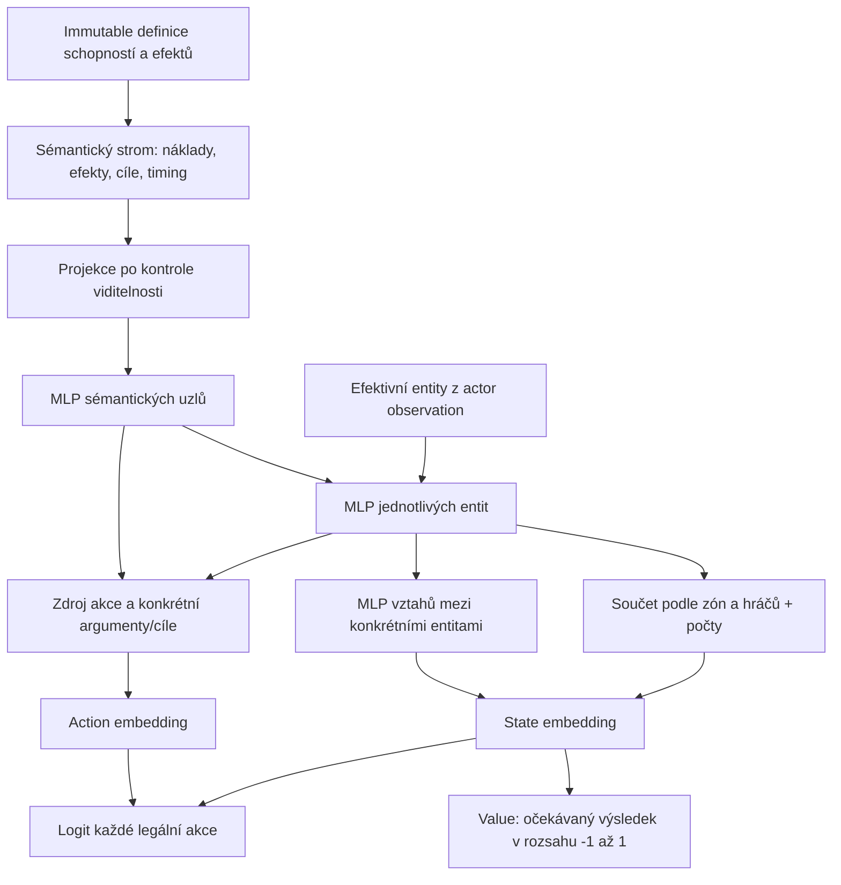
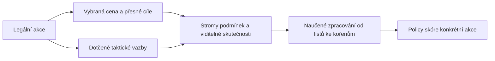

# AI, MCTS a hráčské informace

Aktuální přehled objektů a jejich kontraktů. Pravidla provádí nativní engine;
agent vybírá z nabídek, které engine vytvořil nebo ověřil. Numerické encodery
pro model nejsou náhradou přesného simulovaného stavu.

Mapa implementace je v [AI modulech](../game/ai/README.md), nástroje měření
v [benchmarkech](../benchmarks/README.md). [Tok simulace](MCTS_SEARCH_FLOW_20261106.md)
popisuje okolí funkcí a životnost objektů; jeho časy jsou historické série.
Datované výsledky mají vlastní [index experimentů](experiments/mcts/README.md).

Od 2026-11-10 jsou implementace rozdělené podle vlastníků do podbalíčků
`agents`, `decisions`, `information`, `evaluation`, `search`, `simulation`,
`sampling`, `training`, `experiments` a `reference`. Společné search DTO
patří do `game.ai.search.contracts`; sestavení objektů vlastní
`game.ai.composition.SearchAgentBuilder`. [Rozsah úklidu a ověření](AI_ARCHITECTURE_CLEANUP_20261110.md).

[Rozbor XMage a MageZero](experiments/mcts/MCTS_XMAGE_COMPARISON_20261107.md)
odděluje jejich skutečné kopírování a strukturu stromu od návrhů pro Cards.
[Zkoušky dalších cache identity](experiments/mcts/MCTS_IDENTITY_CACHE_TRIALS_20261107.md)
zůstávají explicitními experimenty; samotný pokles počtu renderů není přijetí optimalizace.

## Současné režimy a vlastnictví

Na větvi `feat/pimc-sampled-worlds` přibyl explicitní
`search_backend="pimc"`: sampler použije skutečnou paměť jednou a
vytvoří úplné hypotetické světy bez simulační knowledge/recall. PIMC
vybírá přes samostatné stromy stavových cest, nikoli přes hráčské
informační identity. Výchozí `information_set` se nemění.
[Architektura, zapnutí, omezení a měření](experiments/mcts/MCTS_PIMC_MEMORY_BOUNDARY_20261109.md).
Volitelné `pimc_leaf_policy="first_leaf"` ukončuje trajektorii na prvním
novém listu s dořešeným stackem a bojem; výchozí `"horizon"` se nemění.
[Algoritmus a srovnání](experiments/mcts/MCTS_FIRST_LEAF_20261109.md).
Také IS-MCTS podporuje explicitní `information_set_leaf_policy="first_leaf"`:
ukončuje rollout na prvním novém dořešeném listu při zachování informačních
uzlů, paměti a actor-filtered policy. Výchozí hodnota je `"horizon"`.
[Přesný kontrakt a měření před/po](experiments/mcts/MCTS_IS_FIRST_LEAF_20261109.md).
Kontrakty hráčských informací níže se vztahují ke stávajícímu IS-MCTS;
PIMC je explicitní aproximace s úplnou znalostí sampled světa.

| Oblast | Současný kontrakt |
| --- | --- |
| Hráčské snapshoty | Výchozí dostupné rozhraní s oddělenými historickými fakty. |
| Živé observations | Volitelné `runtime_observations=true` pro sériový current-world search s nativními heuristickými konzumenty. `State.observation_for(player)` čte živý svět; strom uchovává oddělenou identitu, hodnocení a metadata. Celé historické observations v tomto režimu neexportuje. |
| Odvozená pole a digesty | Cache mají vlastníka a ověřované závislosti. Inkrementální podotisky a seed banky se mohou přebírat mezi důvěryhodnými kopiemi; obecná sanitizace začíná studená. Živé handles zůstávají world-local. |
| Karty | `State.cards` registruje karty, `State.card_states` jejich měnitelné záznamy. Zóny mají ID backing. Card stále patří konkrétnímu runtime světu. |
| Statické definice | Publikované kontextově nezávislé grafy se sdílejí přes reference. Konkrétní operace, zdroje a bound efekty zůstávají runtime daty; samotné `frozen=True` není důkaz sdílení. |
| Vratný pracovní runtime | Explicitní `CurrentPositionWorlds(reuse_world=True, reversible_world=True)` vrací po trajektorii původní objekty, knowledge a RNG. Checkpointy mají vlastní kopie a prefix se nadále přehrává. |
| Strukturální katalog | Volitelný katalog ověřených popisů má omezený RAM scope. Kontroluje živé vstupy a sám o sobě není doporučením změnit herní preset. |

V presetu `configs/mcts_play_128_native.json` je `reuse_world=true`, což samo
nezapíná vratný worker ani živé observations. Při změně režimu se uplatní
validace v `game.simulation.search_config`. Poslední měření odstranila kopie
publikovaných definic; stabilní zrychlení celého search ani cíl 2× neprokázala.
Podmínky a čísla jsou ve [zprávě o definicích](experiments/mcts/MCTS_IMMUTABLE_DEFINITIONS_20261107.md)
a [inventuře objektů](experiments/mcts/MCTS_OBJECT_INVENTORY_20261107.md).

[Nový exkluzivní profil](experiments/mcts/MCTS_RUNTIME_PROFILE_20261107.md)
měří současnou živou cestu s běžným kopírováním při 128 / 4 / 8. Reference
trvaly 44,70 / 41,69 s; v instrumentovaných průchodech dominuje informační
identita a čtení, potom GC a kopie světa. Vratný worker tato série neměří.

[Detail funkcí identity a cache](experiments/mcts/MCTS_IDENTITY_DETAIL_20261107.md)
odděluje čtení a validaci před hitem od samotného skládání hashů. Obsahuje
diagram, počty volání, pomocné objekty a pořadí navržených optimalizací.

[Bezeztrátová abstrakce](MCTS_EXACT_ABSTRACTION.md) odděluje přesné klíče
světa/search od dostatečných vstupů vestavěné heuristiky. Volitelně sdílí
hodnocení a pořadí akcí, včetně konzistentního přejmenování fyzických ID;
automaticky neslučuje návštěvy ani výsledky různých světů.

## Objekty rozhodování

| Objekt | Odpovědnost |
| --- | --- |
| `MCTSAgent` | Živý controller, paměť hráče, příprava search a aplikace vybrané nabídky. |
| `DecisionProjector` | Převod jednoho nativního requestu na hráčské informace a lokální vazby. |
| `ProjectedDecision` | Oddělené portable informace a vazby na konkrétní nativní možnosti. |
| `PlayerInformation` | Aktuální pohled jednajícího hráče, jeho recall a nabídnuté akce. |
| `PlayerAction` | Úplná viditelná identita akce, bez odkazu na nativní svět. |
| `InformationSetSearch` | UCT/PUCT nad informačními uzly a vzorkovanými světy. |
| `InformationSearchBudget` | Neměnné limity trajektorií, světů, hloubky a přechodů. |
| `InformationSearchResult` | Doporučení, statistiky akcí a explicitní stav fallbacku. |

Projektor se používá například jako
`DecisionProjector(request, options, recall, store=value_store).build()`.
`result.information` lze předat policy. `result.bind(action)` vrací možnost
platnou pouze pro původní request. Projekce sama akci neprovádí.

## Tři reprezentace hry

Experimentální `CurrentPositionWorlds(..., reuse_world=True, position_world=True)`
obnovuje pozici prioritního kořene při zachování `State`, `Player`, `Card`
a observation handles v jednom pracovním světě. Kopíruje dynamické komponenty;
není to undo log ani sdílení světa mezi sampled realizacemi. Nepodporovaný
kořen použije běžnou kopii. Volba je oddělená od `reversible_world=True`,
který obnovuje původní komponenty v místě.

1. Živý `State` obsahuje i skutečná skrytá data obou hráčů.
2. `PlayerInformation` obsahuje pouze podporované informace konkrétního hráče.
3. Vzorkovaný svět je jedna úplná možná realizace neznámých údajů, ve které
   nativní engine může přesně provádět akce, lízání a řešení efektů.

`CurrentPositionWorlds` připravuje sanitizovaný snapshot a vzorkované kořeny.
Deklarované decklisty jsou explicitní předpoklad, nikoli přístup ke skutečné
soupeřově ruce nebo pořadí knihovny. Historicky podmíněné backendy navíc
ověřují podporovanou shodu historie a pokračování. Nepodporovaný stav se
odmítne; skrytá data se nesmějí doplnit čtením skutečné hry.

Jednající policy dostává vlastní pohled i v simulaci. Soupeřova policy tedy
vidí svou vzorkovanou ruku, naše policy ji bez odhalení nevidí. Stromové klíče
zahrnují hráčské informace a recall. Přechodová cache má navíc vlastnictví
konkrétního deterministického světa; shodný veřejný board k jejímu sdílení nestačí.

## Výběr a progressive widening

| Objekt | Odpovědnost |
| --- | --- |
| `ActionPath` | Neměnná sémantická cesta úplné akce: druh, zdroj, parametry, cíle, platba a finální identita. |
| `HierarchyNode` | Součet priorů, dokončené návštěvy/hodnoty a počet nenavštívených listů prefixu. |
| `ActionHierarchy` | Hierarchický PUCT a aktualizace všech prefixů vybrané úplné akce. |
| `CandidateOrdering` | Stabilní pořadí podle prioru nebo čistě hráčské heuristiky. |
| `ProgressiveWidening` | Neměnný plán růstu počtu připuštěných kandidátů podle návštěv. |
| `CandidateFrontier` | Vlastněný, postupně čtený proud nativních legálních možností. |

Hierarchie nad hotovým menu sama nešetří jeho generování. Nativní kandidátní
pipeline připravuje návrhy před drahými kombinacemi a později může pokračovat
úplným výčtem. Widening omezuje připuštěný prefix podle
`ceil(c * (visits + 1) ** exponent)`, nejméně jednu možnost. Legálnost se tím
nemění. Neúplný prefix se nesmí vydávat za pokrytí celého legálního menu.

Volitelná `candidate_attack_risk` nad nativní generací řadí návrhy útoků podle
veřejného statického rizika blokování. Nabízí all-in, bezpečnější skupiny,
žádný útok a omezené prefixy před beam/úplným pokračováním. Neprořezává
pravidlově legální akce ani neslučuje návštěvy různých karet. Kontrakt,
omezení a měření jsou v [MCTS_ATTACK_CANDIDATES.md](MCTS_ATTACK_CANDIDATES.md).

`candidate_combat_equivalence` přidává proud reprezentantů aktuálních bojových
rolí před konkrétní výčet. Útoky se generují přes počty bytostí ve skupině,
blokování přes uspořádané balíky počtů blokerů. Původní úplné deklarace
zůstávají později dostupné a statistiky různých ID se neslučují. Podrobnosti
jsou v [MCTS_COMBAT_EQUIVALENCE.md](MCTS_COMBAT_EQUIVALENCE.md).

## Vlastnictví trajektorií

`TrajectoryTraversal` vlastní vstupy jedné trajektorie. Nejprve prochází
uložené přechody a forced řetězce. Při prvním neuloženém přechodu může předat
práci objektu `ContinuationTraversal`, který drží stav souvislého průchodu:
původní hranici, vybranou akci, selection generátor, poslední rodičovský uzel,
dokončený výsledek a případnou odloženou chybu.

Callbacky neprovádějí vlastní kopírování při každém stromovém uzlu. Pokračují
uvnitř vlastněného nativního runtime. Chyba search se propaguje až po jeho
bezpečném rozvinutí, aby ji cost/resolution transakce nemohla zaměnit za
neúspěšnou herní operaci. Do cache patří pouze odpojené neměnné hranice.

`SearchSimulator` je přesný referenční/replay adaptér. `CheckpointSimulator`
navíc umí obnovit podporované priority continuations. Změna organizačních
objektů nemění dosavadní počítání hloubky, logical advances ani minimálního
počtu pokusů. Hloubka znamená rozhodovací kroky, nikoli počet tahů.

`checkpoint_admission` řídí připuštění dražšího capture. Výchozí `"eager"`
zachovává původní chování. Volba `"resumed"` v souvislé trajektorii zachytí
jen právě obnovovaný prefix s alespoň `checkpoint_min_visits` návštěvami.
Neuložená hranice se později přehraje nativním replay; nemění se pravidla,
recall ani logický rozpočet. Přímé edge-by-edge volání zachovává původní
admission. Preset `configs/mcts_play_128_native.json` používá `"resumed"`.
Rozpad projekcí, ověření a omezení měření jsou v
[auditu projekcí a checkpointů](experiments/mcts/MCTS_PROJECTION_ADMISSION_20261028.md).

## Pozorování a cache

Volitelný `position_world=True` nyní znovu používá stabilní handles také
u ověřených bojových continuation kořenů. Stále kopíruje dynamické komponenty
při obnově; nejde o obecné undo. `runtime_observation.project_actor` je společný
producer přesné actor informace. Cache rozpisů map a přímé připojení observer
hodnocení zůstávají explicitní experimenty; [výsledky a testy](experiments/mcts/MCTS_RUNTIME_STEPS_20261108.md)
popisují jejich nejistý časový přínos a užší replay kontrakt.

`PlayerObservationBuilder` provádí viditelnost a popis pravidlových údajů.
`Value` a `ValueStore` drží přesné neměnné JSON-shaped hodnoty; interní
`readonly()` čte sdílená pole bez hlubokého rozbalování celého dokumentu.
Veřejné `observation()` a `describe()` vracejí oddělená měnitelná data.

Dočasné záznamy v `observation_projection.py` mají explicitní význam:

- `VisibilityRead`: zkontrolovaný objekt, druh visibility dotazu a jeho výsledek.
- `DescriptionProjection`: hotový popis a jeho tranzitivní visibility závislosti.
- `ProjectedCardRow`: neměnný řádek karty s důkazy potřebnými pro dalšího pozorovatele.

Tyto dočasné záznamy smějí existovat jen během společné projekce neměněného
světa. Obsahují lokální runtime reference a nesmějí se přenést do hráčských
informací ani uchovaného stromu. Další pozorovatel musí reprodukovat i negativní
filtry attachmentů a oprávnění k last-known information.

`CachedEvaluation` pojmenovává výsledek a jeho započtenou velikost.
`EvaluationCache` používá omezený LRU a nespoléhá na procesní RSS. Změna vah
invaliduje závislé výstupy, zatímco příznaky nezávislé na vahách lze zachovat.
`SearchTreeMemory` uchovává souvislou strukturu podle informačních klíčů;
návštěvy vyžadují navíc kompatibilní session, belief, model a horizont.

## Runtime I/O a self-play

### Neuronová policy pro přímé hraní a PUCT

`PolicyValueModel` už obsahuje malou CPU síť se dvěma tanh encodery. Čte
zjednodušený číselný stav a příznaky každé nabídnuté akce; předpovídá logit
akce a hodnotu pozice. `training_features` agreguje viditelné karty, hráče,
efekty, zdroje, cíle a platby. Názvy, fyzická ID ani skutečná skrytá ruka
protivníka nejsou číselnými příznaky sítě. Agregace je ztrátová; stejný vektor
nemusí znamenat pravidlově ekvivalentní pozici.

Stejný checkpoint má dvě použití:

- `NeuralPrior` převádí logity na `P(a)` pro PUCT; search následně upravuje
  rozdělení návštěv podle simulovaných výsledků.
- `NeuralPolicy` vybírá přímo nejvyšší logit z legálních akcí. Controller
  nesestavuje sampler, světy ani strom. Generování legální nabídky, hráčský
  pohled a číselný encoder ale zůstávají součástí ceny skutečného rozhodnutí.

Přímou policy sestaví `game.ai.composition.make_neural_policy_controller(model)`.
Sdílí živou projekci a vazbu na nativní option s `MCTSAgent` v explicitním
režimu `policy_only`; `search` i `world_provider` jsou `None`. Diagnostika má
`reason='policy'`, `used_search=False` a `used_fallback=False`.

Pro match konfiguraci lze použít následující objekt agenta. Cesta checkpointu
je při `run_config` relativní vůči souboru konfigurace; sampler ani znalost
obou seznamů balíčků nejsou pro přímou policy potřeba.

```json
{"type": "neural", "neural": {"model_checkpoint": "../policy.npz", "max_options": 4096}}
```

Self-play vytváří cíl policy z normalizovaných počtů dokončených návštěv
MCTS; hodnotu učí až z terminálního výsledku partie. Neúplné nabídky,
cenzurované search a neterminální partie nejsou trénovacími příklady.
Rozdělení train/validation je po celých partiích. Samotný pokles trénovací
chyby nebo úspěch na jedné taktické pozici nedokazuje herní sílu na nových hrách.

Z `Cards`, s nainstalovaným `requirements-training.txt`, lze explicitně uložit
finální model včetně stavu Adam do nového souboru:

```powershell
python -B -m game.bin.self_play --config configs/self_play_debug.json --save-model policy.npz
```

`self_play_debug.json` je malý ověřovací rozpočet, nikoli nastavení pro silný
naučený model. `--save-model` nepřepisuje existující soubor a nevytváří rodičovské
složky. Bez tohoto parametru zůstává snapshot v RAM. `--checkpoint policy.npz`
umožní navázat na váhy, Adam a počitadlo her; začíná nový replay. `--output` je samostatný
volitelný JSONL log a nemůže sdílet cestu se souborem modelu.

### Průběžné učení přes zadaný počet her

Model se mezi hrami neinicializuje znovu. V rámci jednoho self-play běhu zůstává
společný model, stav optimalizátoru Adam i omezený replay starších trénovacích
pozic. Pro pohodlné řízení počtu her jsou dostupné parametry:

| Volba | Význam |
| --- | --- |
| `--games X` / `total_games` | Celkový počet trénovacích herních pokusů; přebíjí počet `generations`. |
| `--update-every K` / `games_per_generation` | Po kolika hrách se learner aktualizuje. Hodnota 1 znamená po každé hře. |
| `updates_per_generation` | Počet Adam minibatch updates na jedné hranici učení. |
| `batch_size` | Počet trénovacích pozic v jednom minibatchi; nejde o počet her. |
| `replay_capacity` | Maximální počet starších trénovacích pozic ponechaných v replay. |

Poslední skupina může být kratší: 5 her při intervalu 2 vytvoří skupiny 2, 2, 1.
Vyhodnocovací partie mají samostatný rozpočet a do `--games` se nepočítají.
[Continual konfigurace](../configs/self_play_semantic_continual.json) je proto
výchozím způsobem vypíná (`evaluation_games: 0`). Je to malý trénovací rozpočet,
nikoli potvrzené nastavení pro silného hráče.

Z `Cards`:

```powershell
python -B -m game.bin.self_play --config configs/self_play_semantic_continual.json --games 100 --update-every 1 --save-model semantic-policy-100.npz
```

Průběh jedné skupiny je:

```text
aktuální snapshot vah → K her s neměnnými vahami → terminální příklady do replay
                     → Adam updates ze společného replay → nový snapshot pro další hry
```

Váhy se nemění uvnitř partie ani uprostřed jejího MCTS search. Při K větším
než jedna mohou actory odehrát skupinu paralelně; další skupina už dostane
aktualizované váhy. S K=1 se čeká na jednu partii a více actorů nepřinese souběh.
Jestli replay ještě nemá `batch_size` použitelných pozic, learner počká na další
hry. Turn limit, přerušený search nebo neúplná nabídka nevytvářejí falešné cíle.
Starší platná data v replay lze dál používat i tehdy, když nová hra nepřidala
použitelné příklady. Do přepnutí z heuristického bootstrapu se vyžaduje jak
konfigurovaný počet počátečních skupin, tak alespoň jeden skutečný update modelu;
`bootstrap_generations: 0` umožňuje explicitní začátek s náhodnou sítí.

Checkpoint obsahuje vedle vah a Adam také `training_games_seen`. Finite režim
podle něj pokračuje v indexech her, seedech, rotaci balíčků a starting playera:

```powershell
python -B -m game.bin.self_play --config configs/self_play_semantic_continual.json --checkpoint semantic-policy-100.npz --games 100 --update-every 1 --save-model semantic-policy-200.npz
```

Tím se odehraje dalších 100 pokusů a natrénovaný model se nevrací do heuristického
bootstrapu. Starší checkpoint bez počitadla se načte s nulovým pokrokem her.
Replay, held-out příklady a learner RNG se mezi samostatnými spuštěními
neukládají: jde o pokračování vah/Adam/herního streamu, nikoli bitově totožné
obnovení celého předchozího procesu. Model se zapisuje pouze na konci s explicitním
`--save-model`; běžný runtime nevytváří průběžné checkpoint soubory.

Výstup odděluje požadované/odehrané trénovací pokusy, terminální hry, evaluace,
skutečné optimizer kroky a celoživotní počitadlo her. Trénink na 100 hrách proto
sám o sobě neznamená 100 updates ani doloženou herní sílu.

Ověření continual etapy: **130 passed, 21,17 s**. Testy zahrnují skutečné Adam
updates pooled i entity modelu mezi skupinami, sdílený replay, poslední zkrácenou
skupinu, čekání na minibatch, pokračování seedů z checkpointu, oddělení evaluací,
CLI a reálné spawned actory se třemi přesně odměřenými herními pokusy.

### Sémantické entity a Deep Sets — schéma 2

Vedle původní cesty `pooled` je dostupná explicitní reprezentace `semantic`.
Výchozí nastavení starších konfigurací zůstává `pooled`. Nová cesta používá
[CardSemanticEncoder](../game/ai/evaluation/semantic_encoding.py),
[EntityFeatureEncoder](../game/ai/training/entity_features.py) a
[DeepSetsPolicyValueModel](../game/ai/training/deep_sets_model.py).



Sémantický encoder čte publikované immutable definice a interpretuje pouze
konkrétní podporované nativní třídy. Nevolá `to_operations()`, target generation,
podmínky ani callbacky. Rozlišuje náklad a resolution, `all_of`/`one_of`, pořadí
bindings podle nativního `EffectSequence`, místní vazby na target sloty, jejich
minimum/maximum a opakování, mana symboly, použití stacku a sorcery timing.
Názvy karet, texty a authored rule/slot klíče nejsou číselnými příznaky.
Lokální klíče slouží jen k propojení odpovídajících částí stromu.

Podporované efekty zahrnují například damage, draw, gain life, přesun zdroje,
tapnutí, destroy a board wipe, counterspell, sacrifice, přidávání many, countery,
některé dočasné modifiery, attachment a tvorbu tokenů s vlastní definicí.
Nepodporovaná třída, query factory, callbackový trigger nebo dynamický getter
zůstává označen jako `unknown`. Neznámé části nepřekládáme podle názvu třídy
či textu. Sémantický strom není důkazem pravidlové ekvivalence a nenahrazuje
informační identitu MCTS.

Do observations a popisů akcí se sémantická metadata přidávají jen ve scoped
projekci nového modelu. Kontrola viditelnosti se provádí před zveřejněním
definice. Controller scope automaticky otevře a obnoví i při výjimce.
Při nízkoúrovňovém volání `search()` sestavte root information i sampled
simulátory uvnitř `with model.semantic_encoder.projecting():`.

Nový model přijímá proměnlivý počet těchto položek:

| Produkt | Reprezentace |
| --- | --- |
| Globální stav | 42 čísel včetně typu requestu. |
| Entita | 120 čísel; aktuální card/player příznaky, subtypy, rozlišené countery a stack pozice. |
| Sémantický uzel | 334 čísel; druh, rodičovský druh, fáze, hloubka, pozice, skalární a kategoriální atributy. |
| Vztah | Dva lokální indexy entit a 8 čísel pro typ/pořadí/multiplicitu. |
| Akce | 36 základních čísel, zdroj, sémantika konkrétní ability a proměnlivé argumenty. |
| Argument | 11 čísel, zdroj/cíl a sémantika navázaného efektu; zahrnuje cíle, mana sources, X a ordered selections. |

Každá entita projde naučenou nelineární transformací **před** agregací. Pooling
má samostatné skupiny pro oba controllery a pět zón, plus oba hráče. Vztahy
zpracovávají embeddingy konkrétních endpointů; cíle akcí jsou spojené se svými
efekty. Stack má vlastní položky, source/target vazby a explicitní pozici.
Pořadí běžné množiny karet není vstupním příznakem. Pořadí stacku a scry ano.
Embeddingy a součty jsou stále aproximace, nikoli bezeztrátová reprezentace
pravidlového programu. Model zatím nepoužívá attention ani naučený skupinový prior.

Cache immutable definic má nejvýše 512 záznamů. Samostatná cache čistých
číselných sémantických faktů má nejvýše 256 záznamů a účetní limit 16 MiB;
tyto fakty nejsou závislé na vahách. Naučené embeddingy vznikají v aktuálním
forward/backward výpočtu. Inference/feature cache celého modelu zůstává omezená
původními konfiguračními limity. Do worker payloadů se warmed cache nepřenášejí.
Účetní byte limit cache není měření RSS ani celkové RAM tréninku.

`TrainingExample` podporuje původní kombinaci verzí i `encoder_version=2`,
`feature_version=2` s entity daty. Checkpoint nového modelu má `model_version=2`;
`PolicyValueModel.load()` vybere správnou implementaci. Starší pooled checkpointy
se dále načítají. Jejich váhy ani již agregované vstupy nelze použít jako přímý
warm start entity modelu. Self-play odmítá nesoulad modelu a konfigurace.

Spuštění z `Cards`:

```powershell
python -B -m game.bin.self_play --config configs/self_play_semantic_debug.json --save-model semantic-policy.npz
```

Konfigurace volí `model_representation: "semantic"`, hidden 32, jeden actor
a pevný MCTS rozpočet. Heuristický bootstrap už zaznamenává schema-2 příklady;
další generace používají síť jako prior i value. Checkpoint lze použít i přes
stejný přímý `type: "neural"` controller. Tato etapa podporuje sériový search
a snapshot observations; kombinace se živými runtime observations nebo paralelním
search se explicitně odmítá, dokud nebude ověřená propagace projekčního kontextu.

Ověřovací nativní průchod 23. listopadu 2026 dokončil taktickou partii ve třech
simulator advances výhrou hráče 0. MCTS mělo návštěvy `[2,4,2]`; po 40 updates
na tomto jediném příkladu policy vybrala akci 1. Policy loss klesla přibližně
1,3700 → 1,0411, value MSE 0,5397 → 0,000003; checkpoint roundtrip se shodoval.
To je integrační kontrola, nikoli měření generalizace nebo herní síly.

Na stejném malém vstupu a hidden 16 měl nový model 14 785 parametrů.
Medián 100 opakování samotného forwardu byl asi 1,31 ms proti 0,42 ms pooled
modelu; nový encoder s inference a čerstvou cache číselných sémantik měl medián
10 vzorků asi 11,23 ms. Časy nezahrnují živou projekci ani celý MCTS search.
Nejde o doložené zrychlení: přínos bohatší reprezentace je potřeba teprve změřit
na oddělených partiích, kartách a balíčcích při stejném trénovacím/search rozpočtu.

Finální cílená sada této etapy: **405 passed, 101,27 s**. Zahrnuje numerické
gradienty všech vrstev, ragged batch, native PUCT/value s načteným modelem,
spawned self-play pro heuristický i neuronový bootstrap, JSON/model/Adam
roundtrip, neznámé efekty bez vykonání callbacků, viditelnost, permutace entit,
stack pořadí a původní observation/search/clone kontrakty. Celá Cards sada se
v této etapě znovu nespouštěla.

Běžné play/match/tournament/self-play bez explicitního výstupu neukládají
pracovní soubory. Světy, continuations, strom, replay i modelové snapshoty
zůstávají v RAM. Self-play používá nezávislé herní actory a procesové pipes;
`PolicyValueModel.to_bytes()` vytváří snapshot v paměti, ne soubor.

Explicitní logy zůstávají volbou volajícího. Play/match mohou zapisovat JSONL
a čitelný TXT log. Tournament s explicitním output vytváří požadovaný výstup.
Self-play může psát jeden explicitní koordinátorový diagnostický log; jednotliví
actoři nevytvářejí vlastní složky. Stávající checkpoint modelu lze načíst.
Self-play CLI ukládá nový checkpoint pouze s explicitním `--save-model`.
Samostatné benchmarky mohou mít explicitní exportní režim a nejsou běžným runtime.

Používejte `-B` a `PYTHONDONTWRITEBYTECODE=1`, pokud nechcete ani Python bytecode.
Testy s dočasnými vstupy nebo explicitními výstupy jsou testovací fixtures;
runtime no-write kontroly samostatně používají `deny_writes()`.

## DeckProfiler a taktický kontext — schéma 3

Explicitní `model_representation: "deck_semantic"` používá
`DeckPolicyValueModel`, který rozšiřuje Deep Sets o kontext obou povolených
decklistů a aktuální viditelné vazby. Původní modely/schémata 1 a 2 zůstávají
podporované; jejich checkpointy se nepřevádějí automaticky na schéma 3.

`evaluation/card_mechanics.py` čte sémantický strom definice, včetně efektů
uvnitř cost/resolution subabilities a podmínek triggerů. Rozlišuje produkci
událostí, spotřebované zdroje, cíle, opakovatelnost, aktivní zóny a neznámé
části. Nevolá effect/operation generátory, predikáty ani textové popisy.
Pravidla vytvořeného tokenu se nezaměňují za okamžité efekty vytvářejícího spellu.
Nové rozpoznávání lifegain triggerů, counter událostí a scry je izolované
v `DeckSemanticEncoder`. Původní `CardSemanticEncoder` zachovává jejich dosavadní
unknown reprezentaci pro modely schématu 2.

`evaluation/deck_profile.py` vlastní `DeckProfiler`, immutable `DeckProfile`,
`DeckCardProfile`, `RoleAssignment`, `MechanicLink` a `DeckPlan`. Profil vzniká
jednou při připojení povolených decklistů k modelu. Nemá odkazy na runtime
světy, karty ani naučené embeddingy. Identita definice se používá jen pro cache;
katalogové názvy pouze propojují záznamy, nejsou číselnými vstupy sítě.

Slovník obsahuje resource, card advantage, selection, enabler, payoff, engine,
threat, finisher, interaction, protection, stabilizer a recovery. Přiřazení je
doložené konkrétní schopností, podmínkami a případnými odkazy na podpůrné vazby.
Například Hallowed Priest dostane lifegain payoff pouze s nalezeným producentem
lifegainu. Bez něj zůstane mechanická schopnost a `missing_support`. Neznámý
callback znamená neúplné pokrytí, nikoli důkaz absence podpory. Selection se
rozpoznává například z nativního `ScryEffect`; původní scry callback je nahrazen
deklarativní definicí se stejnou `ScryOperation`. Finisher se zatím přiřazuje
úzce jako podporovaný opakovaný damage payoff s podmínkami zásahu soupeře a
dostatečného opakování, nikoli podle libovolného prahu síly nebo damage.
Označuje potenciální ukončení plánu, ne prokázaný lethal. Strukturální `DeckPlan`
seskupuje vazby podle události; není důkazem fungujícího či nekonečného comba.

`evaluation/tactical_context.py` přijímá pouze oddělený hráčský pohled, volitelně
dva seat-indexed profily a legální nabídku akcí. Používá aktuálně promítnuté
schopnosti a controller, nikdy neobnovuje odstraněnou schopnost z katalogu podle
jména. Skryté/face-down identity vynechává. Karty mimo decklist nebo s novými
schopnostmi mohou vytvářet viditelné mechanické vazby také.
Plná taktická analýza vyžaduje pohled vytvořený pod
`DeckSemanticEncoder.projecting()`; controllery se schématem 3 jej zapojují
automaticky. Chybějící sémantiky ve starším záznamu se nedoplňují odhadem.

| Produkt | Obsah a význam |
| --- | --- |
| `TacticalCard` | Reference včetně zone revision, aktuální controller/zóna, viditelné schopnosti a role. |
| `TacticalConnection` | Konkrétní zdroj/příjemce, schopnosti, mechanika a dosud nutné podmínky. |
| `MissingRequirement` | Požadovaná událost bez nalezené dostupné viditelné podpory. |
| `ActionConnection` | Konkrétní zdroj, cíle, cost/effect sémantika a související vazby nabídnuté akce. |

`conditional_present` znamená, že zdroje schopností jsou v jejich aktivních
zónách; **neznamená**, že schopnost lze právě aktivovat nebo že se událost stane.
`preparable` znamená potřebný viditelný zdroj v ruce, `unavailable` například
neaktivní zdroj v hrobě. Lifelink nadále vyžaduje skutečné kladné damage. Vrstva
nesimuluje vyhodnocení stacku, neověřuje plnou zaplatitelnost, timing ani cíle;
tyto otázky zůstávají pravidlovému enginu a přesné nabídce akcí.
Graf nyní primárně propojuje producenty událostí s odpovídajícími triggery.
Spotřeba zdrojů, cíle a alternativa větvení zůstávají explicitními požadavky;
vrstva neprovádí obecný důkaz dostupnosti všech zdrojů či pořadí kroků plánu.

```python
from game.ai.evaluation.deck_profile import DeckProfiler
from game.ai.evaluation.tactical_context import TacticalContextBuilder

profiler = DeckProfiler()
profiles = tuple(profiler.profile(deck, catalog) for deck in permitted_decks)
context = TacticalContextBuilder().build(
    information.current.observation(), profiles, information.actions)
links = context.connections_for(context.cards[0].reference)
```

Schéma 3 přidává samostatné entity pro jednotlivé typy karet decklistu s počtem
kopií, příznaky rolí, statickými sémantikami a vazbami. Viditelné runtime entity
mají vlastní příznaky a taktické hrany. Skupiny jsou relativní k actoru; informace
o pozici a parametrech legálních akcí ze schématu 2 se zachovávají. Naučené
transformace předcházejí agregaci. Statické číselné vstupy se předpočítají při
`bind_decks`; naučené embeddingy se přepočítají v každém forward grafu i při
tréninku. Cache predikcí zahrnuje otisky obou profilů a při změně profilu se resetuje.

`SearchAgentBuilder` připojí explicitní `GameOrigin` automaticky. Přímá neural
policy se schématem 3 potřebuje profily nebo `origin`; v JSON konfiguraci navíc
výslovné `neural.deck_knowledge: "both_lists"`. Checkpoint obsahuje váhy,
optimizer a verze, nikoli decklist konkrétní hry. Po načtení se připojují decklisty
nové hry. Self-play to dělá pro každou epizodu včetně heuristického bootstrapu.
Schéma 3 zatím používá snapshot observations a sériový MCTS; herní actory mohou
nadále běžet v samostatných procesech.

Trénovací vzorek zachovává oddělené číselné příznaky a lokální indexy hran před
akcí, celé rozdělení návštěv MCTS nad přesnou nabídkou a skutečný terminální
výsledek. Neobsahuje runtime `State`, skryté karty nebo pouze jméno vybrané karty.
Novou cestu lze spustit konfigurací `configs/self_play_deck_continual.json`.
Její lepší herní síla ani rychlost zatím nejsou doložené.

Ověření této etapy: **151 passed, 25,68 s** v cílené sadě deck profile/model,
semantic encoding, Deep Sets, continual/self-play, neural policy, search config,
search encoding, starter cards a static definitions. Kontroly zahrnují
podmíněné role, odebrané schopnosti, ukradené a generované karty, skryté identity,
samostatné cíle jednotlivých efektů a hráčské cíle, permutace deck entit i seatů,
numerické gradienty, JSON/checkpoint/Adam roundtrip, skutečný nativní PUCT a dva
spawned self-play průchody. Tyto průchody končí turn limitem a nevytvářejí
vymyšlené terminální trénovací štítky. Runtime kontroly používají `deny_writes`;
nevznikl herní log, naučený checkpoint ani benchmarkový výstup. Celá Cards sada
nebyla znovu spuštěna. `git diff --check`, syntaxe a whitespace upravených a nových
Python souborů prošly.

## Strukturované podmínky a taktika akcí — schéma 4

`model_representation: "tactical"` používá `TacticalPolicyValueModel` a
`configs/self_play_tactical_continual.json`. Schémata 1–3 zůstávají podporovaná;
nová stromová vrstva má vlastní váhy a vyžaduje nový checkpoint schématu 4.
Výchozí heuristický search ani starší konfigurace se automaticky nepřepínají.

| Produkt | Vlastnictví a význam |
| --- | --- |
| `Requirement` | Neměnný strom AND / OR / sequence, fáze cost/effect/condition, subjekt, množství a konkrétní omezení. |
| `RequirementAssessment` | Oddělené viditelné skutečnosti: satisfied / unsatisfied / unknown, dostupné množství a reference s zone revision. |
| `ActionTacticalContext` | Podmínky jednotlivých vazeb a jejich konkrétní účast v každé nabídnuté akci. |
| `TacticalEntityAction.argument_parents` | Lokální indexy rodičů argumentového lesa; žádné odkazy na runtime či naučené identity. |

`evaluation/tactical_requirements.py` zachovává cenu, cíle, barevné/generic/hybrid
mana požadavky, min/max, proměnné, trigger omezení a alternativy. Variable cost
a variable effect se nezaměňují. OR větve se nepovažují za současné výhody:
událost má také guard vyžadující větev, která ji může vytvořit. Číselná hodnota,
typ counteru, typ karty, zóna, událost nebo fáze tahu se předávají konkrétně;
počet požadavků už není jejich jediným číselným popisem.

Hodnocení je lokální a nepřebírá roli enginu. Prázdný mana pool není důkaz
nezaplatitelnosti, pokud mohou existovat neaktivované mana sources. Přesná
platba již nabídnuté nativní akce má samostatnou informaci o potvrzeném payment
plánu. V konjunkci se tentýž tap, sacrifice, životy nebo mana pool nepovažují
za nezávisle opakovaně dostupné. Tap-then-sacrifice se odlišuje od opačného
pořadí. Náročné nebo neúplně popsané případy zůstávají `unknown`; neběží druhý
mana solver, validace všech pravidel ani symbolický důkaz comba.

`evaluation/action_tactics.py` používá konkrétní vybrané efekty, jejich oddělené
target slots a mana activation receipts. Pořadí platby odpovídá nativnímu
`BoundActionGenerator`: mana activations, spend mana, pay life, vlastní cost
effects. Reference mana ability patří jejímu vlastnímu source, nikoli source
spellu. Vznikají zejména tyto podmíněné vztahy:

- `produces_event`: zvolená větev může vytvořit událost pro odpovídající schopnost;
- `develops_source`: zahrání produceru nebo payoffu připravuje část vazby;
- `spends_source`: cena spotřebuje zdroj důležitý pro další podporu;
- `affects_source` / `protects_source`: konkrétní efekt zasahuje nebo chrání
  zdroj schopnosti s vazbami v aktuální pozici.

Zahrání lifelink bytosti není okamžité získání životů. Obětovaný battlefield
payoff se nezapočítá do pozdějšího resolution lifegainu; vlastní dies trigger
zůstává potenciálně možný přes last-known information. Vztahy neznamenají
zaručené resolution, zničení cíle ani lethal. Současná síla karty v ruce se
nepovažuje za definitivní sílu po vstupu na battlefield.

`TacticalSemanticEncoder` izolovaně přidává reviewed nativní podmínky útoku,
více útočníků, malé vstupující bytosti, blokování, začátku fáze, spell cast
a damage včetně combat/player/source omezení. Starší encodery zachovávají
svou dosavadní reprezentaci. V katalogu 91 definic klesl počet definic s alespoň
jedním unknown markerem z 62 na 59 a počet výskytů unsupported trigger
condition z 18 na 7. Nejde o procento správně vyhodnocených karet: neznámý
effect/predicate/continuous callback může zůstat na stejné kartě.

`training/tactical_features.py` předává podmínky i vztahy přímo jednotlivým
akcím, včetně vazeb na oba konce. `training/tactical_model.py` počítá naučené
embeddingy od listů k rodičům; do action poolu vstupují pouze kořeny. Typ
operátoru je součástí vstupu. AND/OR mají různé reprezentace, jejich nezávislé
děti lze permutovat; sequence zachovává pozici. Gradient prochází také
`wtree` a všemi původními vrstvami. State/value část nadále agreguje typované
vazby pomocí Deep Sets; není to obecný vícekrokový plánovač nebo celý GNN.



Checkpoint má navíc `tactical_version`; JSON trénovacích dat uchovává parent
indexy a schéma 4. Obnova Adam stavů, přímá neural policy, PUCT/value i actor
snapshoty používají stejnou verzi. Stejně jako schéma 3 vyžaduje explicitní
povolené decklisty, snapshot observations a sériový MCTS. Self-play actory
mohou být samostatné procesy. Neaktualizuje se tím belief smlouva ani počet světů.

### Cena a opakované použití číselných faktů

Profil malé scény ukázal přibližně 830 tisíc opakovaných `isfinite`/type kontrol
za jedno zakódování. `SemanticRows` nyní označuje jednou ověřené hluboce neměnné
číselné sémantiky. Veřejný konstruktor a externí JSON se validují; kompozice
ověřených řádků se nemusí znovu skenovat. Statické deck summaries a role/link
příznaky se počítají při připojení balíčku. Nová bounded cache uchovává readonly
číselné NumPy matice, nikoli embeddingy závislé na vahách. Má limit 256 položek
a 32 MiB konzervativně účtovaných dat, není součástí checkpointu/IPC a resetuje
se při připojení nových profilů. Ostatní cache mají vlastní limity. Trénink
stále přepočítává všechny naučené transformace a zachovává jejich gradienty.

Orientační měření `lethal_shock`, hidden 8, tři akce, 39 entit, 12 vzorků
s obraceným pořadím variant, zahřáté statické fakty, přímé volání encoderu
a forwardu bez prediction cache, původní GC a `deny_writes`:

| Schéma | Encoder před úpravou | Encoder po úpravě | Forward před úpravou | Forward po úpravě |
| --- | ---: | ---: | ---: | ---: |
| 3 | 46,12 ms | 3,06 ms | 15,17 ms | 2,81 ms |
| 4 | 99,69 ms | 10,73 ms | 17,66 ms | 4,66 ms |

Časy jsou mediány oddělených komponent. Schéma 4 má v této scéně 118 vazeb
a 23 argumentů proti 38/9 ve schématu 3; bohatší cesta zůstává dražší.
Příprava modelů, projekce runtime ani celý search v těchto intervalech nejsou.
Nejde o měření celé hry, peak RAM, obecný speedup MCTS nebo důkaz herní síly.
Žádné aplikace ani globální GC nastavení se při měření neměnily.

Finální cílené ověření schématu 4: **176 passed, 36,74 s**. Sada zahrnuje
strukturu a množství podmínek, sdílení spotřebovaných zdrojů, pořadí mana
activations/payment/cost effects, odlišné OR větve, připravení produceru i
payoffu, spotřebu payoffu a last-known dies trigger. Kontroluje všechny
gradienty včetně `wtree`, AND/OR a permutace, actor-relative seat swap,
JSON/checkpoint/Adam roundtrip, izolaci numeric cache od naučených výstupů,
skutečný nativní PUCT a spawned self-play pro oba bootstrap režimy. Zahrnuté
jsou předchozí deck/semantic/Deep Sets/continual/self-play/neural policy,
search config/encoding, starter a static definition testy. Celá Cards sada
nebyla znovu spuštěna.

Krátké self-play testy končí turn limitem bez vymyšlených terminálních štítků.
Test kapacity sítě na odlišných podmínkách je syntetický a není důkazem lepšího
hraní. Delší trénink a nezávislé porovnání proti schématu 3 zůstávají otevřené.
Runtime kontroly i měření používají `deny_writes`; nevznikl herní log, naučený
checkpoint ani profilový soubor. `git diff --check`, syntaxe a whitespace
upravených/nových Python souborů prošly.

## Spuštění a ověření

Z adresáře `Cards` s aktivovaným prostředím projektu:

```powershell
python -B -m game.bin.play --ai-agent mcts --mcts-known-decks --mcts-settings configs/mcts_play_128_native.json
python -B -m game.bin.self_play --config configs/self_play_debug.json
python -B -m pytest tests -q -p no:cacheprovider
```

Hodnoty presetu nejsou důkazem obecné herní síly. Časový limit search je měkký
a nemusí zahrnovat všechny živé kroky před jeho zavoláním. Výchozí jeden worker
zachovává sériový search; více workerů používá nezávislé kořenové stromy se
sloučením statistik, nikoli nové vlákno pro každý stromový uzel.

## Styl a úklid

AI/MCTS používá pojmenované datové záznamy pro skutečné doménové hodnoty
a objekty s explicitním vlastnictvím pro stavové postupy. Krátké čisté funkce
pro matematiku, serializaci nebo interoperabilitu zůstávají funkcemi.
Dokumentační komentáře používají styl `data_structs`: `@brief`, `@var`,
u důležitých rozhraní také `@param`, `@return` a `@throws`.

Odstraněna byla stará funkční rozhraní `action_path`, `candidate_order`,
`widened_candidates`, `run_trajectory` a `project_decision`; interní volající,
benchmarkové adaptéry a testy používají nové objekty. Mana solver patří přímo
do `game.mana.mana_solver`; starý AI importní shim byl odstraněn.

Projektové návody a reporty patří do `docs`; lokální README v AI a benchmarkech
slouží jako mapy zdrojů. Historické reporty mimo tuto strukturu,
jednorázové Python skripty a kopie zdrojů v `runs` byly odstraněny. Naměřené
JSON/JSONL/TXT výsledky zůstaly zachované. Nainstalované závislosti v `.venv`
jsou mimo úklid zdrojových souborů.

Datované výkonnostní a validační výsledky patří do `docs/experiments/mcts`;
rozsáhlé generované tabulky do `docs/generated`. Historická čísla testů
předchozí reorganizace jsou v [samostatném záznamu](experiments/mcts/REPOSITORY_LAYOUT_HISTORY.md).
Aktuální kontrolu úklidu popisuje [záznam z 2026-11-07](REPOSITORY_CLEANUP_20261107.md).
