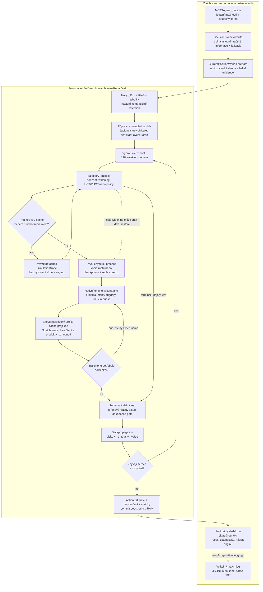
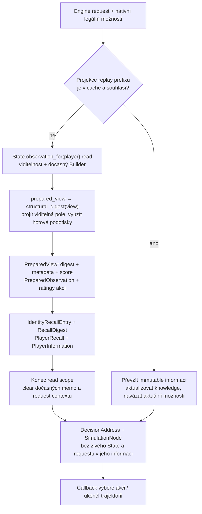

# Tok MCTS search, cache, alokace a soubory — 2026-11-06

Nejnovější [profil z 2026-11-07](experiments/mcts/MCTS_RUNTIME_PROFILE_20261107.md)
měří současný zdroj po sdílení definic. Níže uvedené tabulky nadále patří
svým historickým sériím.

[Srovnání XMage a MageZero](experiments/mcts/MCTS_XMAGE_COMPARISON_20261107.md)
rozebírá jejich skutečné kopie, uzly a obnovu simulace s odkazy na konkrétní revize.

Novější [neměnné sdílené definice](experiments/mcts/MCTS_IMMUTABLE_DEFINITIONS_20261107.md)
odstraňují opakované kopie katalogových předpisů. Tato zpráva má vlastní
aktuální čítače a časy; starší čísla v rozboru toku níže se nepřepisují.

Tento rozbor a časy zachycují **volitelnou živou cestu před inkrementálními otisky**:
`runtime_observations=True`, nativní current-world backend, sériový search,
heuristický PUCT, native widening, checkpoint admission `resumed`, 128 iterací,
4 sampled worlds, depth 8, extensions 16, limit 32 768 logical advances,
bez časového limitu. Výchozí snapshot cesta zůstává dostupná; není automaticky
přepnuta na tuto variantu.

Čísla jsou pro zaznamenané kořeny **87 (priorita) / 102 (útok)**, nikoli pro
celou partii. Navazuje na [cache a aktuální exkluzivní profil](experiments/mcts/MCTS_RUNTIME_FIELD_CACHE_20261105.md).
Následná [implementace inkrementálních otisků](experiments/mcts/MCTS_INCREMENTAL_DIGEST_20261106.md)
mění práci při sestavení identity; níže uvedené profily nejsou jejím novým měřením.
Další [dědění kořenových a karetních otisků](experiments/mcts/MCTS_DIGEST_REUSE_20261106.md)
přenáší ověřitelné digesty při restore a inkrementálně hashuje i live karty.
Nový [profil po těchto změnách](experiments/mcts/MCTS_DIGEST_COSTS_20261106.md) obsahuje aktuální
exkluzivní časy a počty kopírovaných objektů; níže zůstávají historická měření.
Navazující [optimalizace zásahů do cache a rozbor světů](experiments/mcts/MCTS_CACHE_HITS_AND_WORLDS_20261106.md)
odstraňuje pomocné alokace a vysvětluje rozdíl mezi informačním uzlem,
uloženým přechodem a vlastněnou kopií runtime.
Další [vratný pracovní runtime](experiments/mcts/MCTS_REVERSIBLE_WORLD_20261107.md) zavádí
opakované použití stejného světa po celé trajektorii. Malý diferenciální search
snižuje fyzické kořenové kopie šest → dvě; stabilní časový přínos ještě nemá.

Následující [oddělení identity a stavu karet](experiments/mcts/MCTS_CARD_STATE_SEPARATION_20261107.md)
převádí zóny na ID a soustřeďuje měnitelné údaje do karetních záznamů.
Obsahuje také nová plná měření vratného backendu při 128 / 4 / 8; výše uvedené
omezení malých běhů popisuje původní etapu.
Aktuální [inventura objektů po rozdělení karet](experiments/mcts/MCTS_OBJECT_INVENTORY_20261107.md)
měří kopie i konstruktory State, Card, BitSet a pozorovacích produktů v obou
backendech při 128 / 4 / 8.

Používají se tři odlišné druhy evidence:

- **Exkluzivní wall/CPU profil:** čas patří právě jedné kategorii; vnořené scope
  a GC jsou rodiči odečtené. Tyto časy lze sčítat.
- **Samostatný cProfile v RAM:** přesné počty volání a self/inclusive čas funkcí
  v tomto instrumentovaném průchodu. Inclusive časy rodičů a potomků se nesčítají.
- **Statický inventář zdroje:** místa explicitní konstrukce objektů a kolekcí,
  nikoli počet vykonaných alokací. Knihovní a interní alokace Pythonu nejsou
  úplně pokryté počítáním konstruktorů.

## Co znamená otisk a klíč

**Otisk** (`digest`) je krátký výsledek výpočtu nad obsahem. Zde jde o 20 bytů
BLAKE2b z typované struktury: objekt, pole, řetězec, číslo atd. Zohledňuje obsah
a pořadí tam, kde je významové; nerozlišuje jen Python ID objektu. Z otisku
nelze zpětně přečíst power nebo životy. Symbolicky:

```text
H({power: 3, toughness: 3, damage: 0}) → A
H({power: 3, toughness: 3, damage: 2}) → B
```

Stejná runtime karta může během simulace přejít z prvního stavu do druhého.
Její reference zůstane stejná, ale její obsah a otisk mají být jiné.

**Informační klíč MCTS** (`PlayerInformation.fast_key`) vybírá položku v tabulce
stromu. Zjednodušeně spojuje verzi kontraktu, hráče, druh rozhodnutí, otisk
viditelných informací, řetězenou identitu recall a kontrakt nabídky akcí.
Při progressive widening obsahuje identitu candidate modelu; šířka menu
se kontroluje zvlášť. Nejde o hash úplného tajného světa, ID karty, soubor
ani vstup neuronové sítě. Dva fyzicky různé sampled světy mohou sdílet
stejný informační uzel, pokud se jejich hráčské informace shodují.
Stejný aktuálně viditelný stůl ale může mít jiný klíč při jiné hráčově historii:
recall může ovlivnit odhad skrytých karet. Samotná reference na `State` nebo
`Card` proto identitu historického informačního uzlu nenahrazuje.

`structural_digest(view)` stále projde viditelná data, zavolá gettery,
normalizuje a řadí klíče a složí otisky. Hotové immutable podstromy popisů
schopností přeskočí pomocí jejich digestu. Otisk celé karty a celé pozice
se zatím inkrementálně neudržuje.

Zdroj: [tvorba otisku](../game/ai/information/structured_values.py#L344),
[složení informačního klíče](../game/ai/information/search_recall.py#L118),
[příprava živého pohledu](../game/ai/information/runtime_observation.py#L390).

## Celý tok



Diagram zobrazuje hlavní větve, nikoli každé volání funkce. V souvislém suffixu
volá nativní callback znovu `trajectory_choices`; netvoří se nová kopie světa
před každou další akcí. Rozšiřování menu může potřebovat samostatné obnovení,
proto počet restores není totožný s počtem trajektorií.

### 1. Skutečný vstupní request

`MCTSAgent._decide` vygeneruje nabídku a vytvoří vstupní `PlayerInformation`
přes běžný `DecisionProjector.build`. Tato jedna skutečná root projekce zůstává
snapshotová i při zapnutém runtime režimu. Vytvoří se bezpečný fallback a vazby
na skutečné engine možnosti. U úplného jednoakčního menu, setupu nebo některých
nepodporovaných stavů se search vůbec nespustí.

`CurrentPositionWorlds.prepare` ověří podporovanou nativní hranici a připraví
viditelností omezenou šablonu: veřejné karty a vlastní povolená fakta, velikosti
skrytých zón, zbývající deklarované karty a belief evidence. Nečte se libovolná
skrytá pozice jako vstup politiky. Příprava skutečného kořene a této šablony
je **před intervalem** níže uvedených search profilů; její čas zde není změřený.

Zdroj: [MCTSAgent](../game/ai/agents/mcts_agent.py#L149),
[world provider](../game/ai/sampling/current_position_worlds.py#L251).

### 2. Nový search a případná retention

`InformationSetSearch.search` otevře scope nativních čtenářů a zkontroluje
podporované konzumenty. `_search` vytvoří `_Run`: tři oddělené RNG streamy,
tabulky stromu, priory, přechody, widening, počítadla a další RAM cache.

`SearchTreeMemory.load` může převzít podstrom, pouze když sedí session,
model/search signature, informační kořen a horizon/belief kontrakt.
Změna belief může vynulovat návštěvy a ponechat strukturu. Toto není
vyprázdnění cache statů na kartě. V měřených cold search začíná planner
a strom čerstvý; nejde o měření reuse mezi dvěma skutečnými tahy.

Zdroj: [search wrapper a retention](../game/ai/search/information_set_search.py#L417),
[RAM podstrom](../game/ai/search/search_tree_memory.py#L142).

### 3. Čtyři světy v poolu

Pro každý world seed vznikne simulator a `_PreparedWorld`. `_Snapshot.materialize`
zkopíruje sanitizovaný kořen, doplní sampled hand/library karty, jejich registry,
RNG a vlastní knowledge každého hráče. `_PreparedWorld` uchová **nikdy nevykonanou
sampled šablonu**. Do větví pak dává její vlastnické kopie. `sim.start()`
spustí nativní pokračování po první rozhodovací hranici a ověří shodu s root info.

Vzniknou 4 světy pro celý search. **128 iterací je dohromady nad poolem,
nikoli 128 pro každý ze čtyř světů.** Svět se pro trajektorii vybírá pomocí RNG.

Zdroj: [pool a iterace](../game/ai/search/information_set_search.py#L550),
[_PreparedWorld](../game/ai/sampling/current_position_worlds.py#L283),
[sampling a registrace](../game/ai/sampling/current_position_worlds.py#L541).

### 4. Výběr akcí a cached prefix

`TrajectoryTraversal.execute` vlastní jednu trajektorii a generátor
`_Run.trajectory_choices`. Ten kontroluje terminal/cutoff, klidný leaf,
rozpočty, widening a forced microchoices. Před první expanzí volí vlastní
hráč přes `tree_action` (UCT/PUCT); soupeř používá observation policy.
Po expanzi vlastní část používá rollout policy nebo náhodný výběr.

`tree_action` může vytvořit `EdgeTable`, `EdgeStatistics`, `RetainedNode`, priory
a pořadí kandidátů. Jejich klíčem je hráčská informace. Naproti tomu klíč
transition cache obsahuje také vlastníka simulatoru a replay historii:
vykonaný přechod jednoho tajného světa se nesdílí jako přechod jiného světa.
Hit vrátí detached uzel bez opětovného vykonání akce. Forced-chain cache může
spojit více takových hitů; každý logický krok se přesto počítá do rozpočtu.

Zdroj: [traversal](../game/ai/search/search_trajectory.py#L36),
[výběr a přechody](../game/ai/search/information_set_search.py#L748),
[generátor pravidel search](../game/ai/search/information_set_search.py#L931).

### 5. Restore, replay a souvislý nativní suffix

Na prvním cache miss přejde řízení do `ContinuationTraversal`. Simulator
obnoví nejbližší podporovaný checkpoint, nebo root šablonu, a přehraje dosavadní
prefix. Existující projekce mohou být převzaté, ale legálnost/descriptor a recall
se ověřují. Pak nativní engine vykonává další akce v témže vlastněném runtime
a callbacky komunikují s generátorem výběru.

`copy_world` kopíruje mutable graf pomocí `SimulationClone`/`RuntimeClone`:
stavy hráčů a karet, kontejnery, registry, RNG a potřebné callbacky/closure.
Prokázané immutable hodnoty se sdílí. Kopírují se i instance přes `__new__`
bez volání jejich `__init__`; počty konstruktorů proto nejsou počty všech kopií.
Připraví se nové registry odvozených dat a opraví se vazby závislé na Python ID.

**Není zde obecný undo rollback větve.** `RuntimeCheckpoint` uvnitř placení
nákladů je jiná, omezená transakce. Přepínání větví tohoto MCTS obnovuje kopie
šablon/checkpointů. Existující omezený rollback priority nebyl plošně nasazen.

Zdroj: [continuation](../game/ai/search/search_trajectory.py#L86),
[checkpoint restore](../game/ai/simulation/checkpoint_simulator.py#L226),
[copy_world](../game/ai/simulation/simulation_world.py#L104),
[vlastnický copier](../game/ai/simulation/runtime_clone.py),
[cost rollback](../game/game_actions/resolution/cost_transaction.py#L29).

### 6. Nová rozhodovací hranice a živé čtení



`RuntimeObservation` i `CardReadContract` jsou opakovaně použité čtečky nad
konkrétním světem. Nevytváří se nová kopie celého karetního řádku pro každý
request. Přesto vznikají malé pomocné kolekce hráčů, zón, referencí, counters,
request context a hashingová data. `prepared_view` vypočte také scalar value.
`project_decision` připraví ratingy nabídnutých akcí, knowledge a recall.

Do detached uzlu vstupují stabilní produkty rozhodnutí. Historický uzel
nemůže obsahovat jen živý pohled: po další akci by stejná reference ukazovala
jinou pozici. Runtime informace uchovává digest/ratingy/metadata a neumí zpětně
exportovat celý historický observation JSON. Skutečný vstupní root ho má.

Zdroj: [nová hranice](../game/ai/simulation/search_simulator.py#L499),
[živé produkty](../game/ai/information/runtime_observation.py#L407).

### 7. Leaf, backpropagation a návrat

Terminální výsledek nebo povolený klidný leaf dodá scalar z pohledu kořenového
hráče; nová cesta ho obvykle již má v `PreparedView`. Náklady evaluace proto
vznikají při přípravě pohledů, nejen u 128 konečných listů. `depth 8` není
osm celých herních tahů; forced a konstrukční microchoices mají zvláštní účtování
a všechny posuny podléhají hard work budgetu.

Po dokončené trajektorii `_Run.search` projde její path a mění `visits/total`.
Na konci vytvoří `ActionEstimate`, metriky a `InformationSearchResult`.
Doporučení používá počty návštěv a při shodě mean value; nedokončená či
nepoužitelná série může vrátit fallback. `SearchTreeMemory.commit` vybere
souvislý podstrom podle node/byte budgetu. **Commit/save zde znamená RAM,
nikoli soubor.** Potom živý agent naváže akci na skutečný request, doplní
recall a zavolá případný diagnostický callback.

## Co se přesně maže z cache

`dict.clear()` odstraní položky slovníku. Samotný slovník a čtečka mohou zůstat
a být znovu použité. Zaniknou jejich reference na dočasné hodnoty; ty se uvolní,
pokud je již nikdo nedrží, nebo je později zpracuje GC při cyklech.

| Vrstva | Co drží | Co nastane na konci jednoho `read()` | Životnost / invalidace |
| --- | --- | --- | --- |
| `Card` native stat cache | Plány modifikátorů a vypočtené staty | **Nemaže se tímto `clear`** | Změna statů/zdrojů/efektů a jejich validace; podle konkrétní cache |
| `Card._mana_fields` | Odvozené cost texty a mana value | Zůstává | Ověření cost/redukce/symbolů/X; kopie karty má studenou cache |
| `State._card_snapshots` | LKI/index/base-characteristic projekce | Zůstává | Vlastní pravidla eligibility; při `copy_world` nový objekt, přenos jen ověřených index rows |
| `ObservationReaders.fields` | LRU max. 256 odvozených popisů + dependency plans | Zůstává | Ověřuje změny a viditelnost; při kopii světa prázdná |
| `RuntimeObservation.rows` | Znovupoužitelné card handles | Zůstává pro karty stále ve stavu | Handle patří světu a viewerovi; nekopíruje se do dalšího světa |
| `RuntimeObservation.memo` | V jedné read session např. seznam hand/battlefield, hráči, combat | **`clear()`** | Další read znovu čte aktuální stav |
| `CardReadContract.memo` | Políčka jedné čtečky, `_base`, `_mana` v tomto read | **`clear()`** | Nejde o vnitřní stat cache samotné karty |
| `RuntimeObservation._versions` | Které dependency plans už byly ověřené v tomto read | **`clear()`** | Příští read musí ověřit změny/viditelnost znovu |
| `RuntimeObservation.extra` | Request context a initial evidence pro tento read | **`clear()`** | Žádný starý request context nesmí přejít do dalšího rozhodnutí |
| Simulator projection/menu/checkpoint cache | Detached projekce a vlastní replay šablony | Tímto se nemaže | Patří jednomu sampled simulatoru/search; mají své limity |
| `_Run.transitions` a forced chains | Detached přechody pro konkrétní svět/historii | Tímto se nemaže | Jeden search |
| `SearchTreeMemory.nodes` | Actor informace, priory, N/W a vazby | Tímto se nemaže | Mezi searchy, pokud platí belief/horizon/session kontrakt a RAM budget |

`read()` navíc nastaví `_builder=None`, takže čtení mimo synchronní scope
explicitně selže. Maže memo čtečky, protože mezi dvěma rozhodnutími mohly
proběhnout mutace nebo rollback; dnes chybí úplný versioning všech těchto polí.
Nemaže tím všechny cache v enginu. Zdroj:
[finally bloku read](../game/ai/information/runtime_observation.py#L254).

## Naměřené náklady a počty volání

### Celý search: exkluzivní čas

Toto je již dokončený profil současné cached runtime cesty z [předchozí etapy](experiments/mcts/MCTS_RUNTIME_FIELD_CACHE_20261105.md). Kontroly bez hooků měly wall/CPU **47,201 / 47,031 s** a **45,750 / 45,656 s**; níže instrumentované průchody celkem **53,692 / 53,438 s** a **50,581 / 50,422 s**. Oba dokončily 128 trajektorií bez fallbacku, se shodnou celou odpovědí, deseti work counters i cache metrikami.

Počet znamená vstup do hooku, nikoli unikátní request nebo objekt. Kategorie jsou exkluzivní; vnořené cache/stat/render/GC scope jsou odečtené. Není správné připsat celých 31–37 % samotnému výpočtu statů.

| Kategorie a okolí | 87 wall / CPU, s | Podíl wall | Vstupy 87 | 102 wall / CPU, s | Podíl wall | Vstupy 102 |
| --- | ---: | ---: | ---: | ---: | ---: | ---: |
| **Informační identita + živá čtení** — `prepared_view → structural_digest` a obaly identity | 16,769 / 16,813 | 31,2 % | 3 316 | 18,572 / 18,859 | 36,7 % | 3 668 |
| **GC** — Pauzy odečtené rodičovským funkcím | 8,212 / 8,297 | 15,3 % | 6 981 | 6,756 / 6,859 | 13,4 % | 5 709 |
| **Kopie světa** — `materialize/copy → copy_world → SimulationClone.copy` | 6,715 / 6,609 | 12,5 % | 210 | 4,910 / 4,875 | 9,7 % | 155 |
| **Nativní pravidla** — `loop.step`: akce, efekty, triggery, SBA, příprava další hranice | 3,929 / 3,953 | 7,3 % | 906 | 2,415 / 2,375 | 4,8 % | 457 |
| **Candidate generation** — Nabídka legálních možností, i při replay a widening | 3,088 / 3,031 | 5,8 % | 2 864 | 2,109 / 1,828 | 4,2 % | 1 615 |
| **Ostatní request** — Replay validace, adresy a balení requestu; ne pouze observation | 2,606 / 2,547 | 4,9 % | 5 620 | 2,974 / 3,109 | 5,9 % | 3 108 |
| **Odvozená field cache** — LRU lookup/admission a freeze; bez níže odečtené validace/renderu | 2,571 / 2,625 | 4,8 % | 167 580 | 2,527 / 2,781 | 5,0 % | 190 878 |
| **Validace dependencies** — `RuntimeFieldCache.read → Dependencies.matches` | 1,530 / 1,531 | 2,8 % | 87 661 | 1,759 / 1,609 | 3,5 % | 101 950 |
| **Policy knowledge** — `KnowledgeSummary.observe/counter_sources` | 1,882 / 1,922 | 3,5 % | 2 634 | 2,127 / 2,000 | 4,2 % | 2 940 |
| **Mana fields** — Vstupní kontroly a getter/render cost/mana value | 1,085 / 0,891 | 2,0 % | 61 845 | 1,165 / 1,156 | 2,3 % | 70 208 |
| **Základní characteristics** — Šest base polí přes engine cache; není to všechno `Card.get_stat` | 0,770 / 0,813 | 1,4 % | 61 845 | 0,699 / 0,578 | 1,4 % | 70 208 |
| **Action binding** — `DecisionProjector._bind_options` | 0,618 / 0,531 | 1,2 % | 1 317 | 0,767 / 0,719 | 1,5 % | 1 470 |
| **Action ratings** — `_Scorer` nad nabídkou | 0,433 / 0,438 | 0,8 % | 6 762 | 0,552 / 0,609 | 1,1 % | 8 184 |
| **Render schopností** — Tělo `PlayerObservationBuilder._ability` | 0,367 / 0,359 | 0,7 % | 3 708 | 0,277 / 0,266 | 0,5 % | 2 790 |
| **Viditelnost** — `PlayerObservationBuilder.__init__`, nikoli celé `build()` | 0,287 / 0,234 | 0,5 % | 4 648 | 0,236 / 0,234 | 0,5 % | 3 744 |
| **Evaluace pohledů** — `StateValueEvaluator.evaluate` při přípravě pohledů | 0,217 / 0,172 | 0,4 % | 1 995 | 0,254 / 0,219 | 0,5 % | 2 194 |
| **Tree selection** — `_Run.tree_action` | 0,161 / 0,156 | 0,3 % | 377 | 0,196 / 0,109 | 0,4 % | 267 |
| **RAM byte accounting** — Retention `owned_size` apod. | 0,131 / 0,125 | 0,2 % | 17 | 0,154 / 0,156 | 0,3 % | 43 |
| Zbývající scope — replay, sampled inicializace, callbacky a ostatní řízení | 2,321 / 2,391 | 4,3 % | — | 2,134 / 2,078 | 4,2 % | — |

Paměťové vzorkování obklopovalo reference i profily; minimum dostupné RAM bylo přibližně 2,03 / 1,85 GiB, systém 85 / 86 % a paging nebyl nulový. Jde o rozklad konkrétních průchodů, ne novou stabilní whole-search ablaci.

### Kolik práce znamená 128 iterací

| Práce | 87 | 102 |
| --- | ---: | ---: |
| Dokončené trajektorie | 128 | 128 |
| Sampled světy | 4 | 4 |
| Logické posuny | 2 114 | 1 358 |
| Nové přechody enginu | 1 020 | 1 176 |
| Transition cache hity | 1 094 | 182 |
| Root restores | 187 | 155 |
| Checkpoint restore hity | 19 | 0 |
| Kopie checkpointu při capture/freeze | 4 | 0 |
| Checkpoint captures | 4 | 0 |
| Přeskočená checkpoint rozhodnutí | 95 | 0 |
| Volání `copy_world` včetně checkpointů | 210 | 155 |
| Nové actor produkty rozhodnutí | 1 317 | 1 470 |
| Připravené actor/observer pohledy | 1 995 | 2 194 |
| Field-cache hity / nové rendery | 157 486 / 10 094 | 183 128 / 7 750 |

V kořeni 87 je 210 kopií = 187 root restores + 19 checkpoint restores + 4 kopie ukládaných checkpointů. Nejde o 210 sampled worlds. Většina práce vzniká v dalších 127 trajektoriích, ne při prvním sestavení čtyř šablon.

### Detail funkcí: samostatný call audit

Nově proběhla jiná série s `cProfile`, bez per-scope hooků a bez GC timeru. Neprofilované reference měly **46,019 / 45,272 s**, profilované search **121,373 / 113,557 s**. Instrumentace milionů volání je drahá, proto následující časy neslouží jako běžná latence ani se nepřičítají k předchozí tabulce. Profil obaluje `sample()`, tedy i krátké vytvoření detached planneru a vstup/výstup benchmarkového kontextu; stopwatch v souhrnu měří jen search. Zachycení rootů a produkce reportu jsou mimo profil.

`self` = tělo bez potomků; `inclusive` = tělo včetně potomků. Rekurze se počítá mezi volání. U generátorů se naopak počítají i obnovení po `yield`, proto zde nejsou zaměněna za počet nových generátorů.

| Funkce | Volání 87 / 102 | Self s 87 / 102 | Inclusive s 87 / 102 | Přímý kontext |
| --- | ---: | ---: | ---: | --- |
| [project_decision](../game/ai/information/runtime_observation.py#L404) | 1 317 / 1 470 | 0,097 / 0,107 | 72,289 / 76,936 | `_Replay._decide_options`: celá nová rozhodovací projekce |
| [prepared_view](../game/ai/information/runtime_observation.py#L390) | 1 995 / 2 194 | 0,031 / 0,033 | 59,112 / 61,017 | `project_decision`: digest, metadata a hodnota actor/observer |
| [structural_digest](../game/ai/information/structured_values.py#L344) | 4 646 091 / 5 147 969 | 16,628 / 18,169 | 58,076 / 59,891 | Rekurze z pohledu + dependency identity; **není 4,6 mil. observations** |
| [__getitem__](../game/ai/information/runtime_observation.py#L134) | 3 527 587 / 4 105 643 | 2,906 / 3,333 | 27,421 / 27,724 | Karetní Mapping: hashování, evaluace a policy |
| [read](../game/ai/information/runtime_observation.py#L142) | 2 102 730 / 2 387 072 | 2,695 / 3,037 | 22,159 / 21,711 | Tělo getteru při miss dočasného memo |
| [get_stat](../game/game_state/card.py#L708) | 1 315 936 / 1 061 666 | 1,493 / 1,195 | 7,488 / 3,973 | Celý engine: pravidla, generation, controller/types/keywords i observation |
| [matches](../game/ai/information/runtime_field_cache.py#L39) | 87 661 / 101 950 | 0,830 / 0,752 | 3,257 / 3,484 | Ověření závislostí přetrvávající cache |
| [freeze](../game/ai/information/structured_values.py#L188) | 397 561 / 297 818 | 1,732 / 1,033 | 3,227 / 2,107 | Immutable popisy, metadata, deskriptory; ne celá live observation |
| [_counter](../game/ai/evaluation/search_abstraction.py#L86) | 2 094 030 / 2 418 150 | 1,250 / 1,467 | 6,958 / 8,579 | Knowledge evidence: kontrola vlastností viditelných karet |
| [copy_world](../game/ai/simulation/simulation_world.py#L104) | 210 / 155 | 0,059 / 0,043 | 16,614 / 11,957 | Root/checkpoint restore a freeze |
| [copy](../game/ai/simulation/simulation_clone.py#L98) | 3 771 148 / 2 595 785 | 7,787 / 5,787 | 15,086 / 10,827 | Rekurzivní průchod mutable grafem jedné kopie |

**Proč getter cache sám neodstranil cenu:** každý nový pohled stále projde schéma všech viditelných karet. Pro každé pole provede Python dispatch, lookup memo, případnou kontrolu viditelnosti a následně typované hashování. `structural_digest` má miliony rekurzivních vstupů, tvoří klíčové slovníky, seřazené seznamy, bytes a hashery; dohromady zaznamenal BLAKE2 **16 127 284 / 17 981 992** volání `update`. Současně běží znalostní sken `_counter`. Vrácení již spočítaného power je pouze jedna malá část tohoto průchodu.

Inkrementální identita by mohla přeskočit celé nezměněné podstromy. Musí však zahrnout změny zón, viditelnosti, counters, vazeb, popisů a recall, nejen šest statů. Toto je závěr ze zdroje a profilů, nikoli změřený příslib dalšího zrychlení.

Úplná [tabulka 214 funkcí, jejich rodičů a 240 kódů konstruktorů](generated/MCTS_FLOW_CALL_COUNTS_20261106.md) obsahuje i ostatní zaznamenané položky.

## Kde vznikají nové objekty

Níže jsou významné rodiny v pořadí flow. Čísla konstruktorů pocházejí z call auditu; neudávají peak, velikost ani počet objektů, které zůstaly živé. `__post_init__` je druhá metoda stejného objektu; nepřičítá se k `__init__`. Inherited konstruktor může obsloužit více podtříd a vlastnická kopie může `__init__` úplně obejít.

| Místo / vznikající data | Spouštěč a životnost | Volání konstruktoru 87 / 102 |
| --- | --- | ---: |
| `MCTSAgent`: root observation/akce/bindingy, fallback; `_Snapshot` a evidence | Skutečný request před měřeným intervalem | Zde neměřeno |
| `_Run`, RNG, dict/Counter, seznam poolu, path, doporučení a metriky | Jeden search; path na trajektorii; retention část může přežít | `_Run` 1 / 1; simulator 4 / 4 |
| Sampled `Card` + `CardRuntimeState`, registry a hráčské knowledge | Sestavení čtyř šablon; **nezahrnuje kopie přes `__new__`** | 356 / 352 každého typu |
| `SimulationClone`, dict/list/set a shell kopie přes `object.__new__`, closure/RNG | `copy_world`; vlastněný svět pro větev nebo checkpoint | Copier 210 / 155; `object.__new__` celkem 756 321 / 575 964 |
| `_ReplayController`, replay historie a recall, engine loop/executory/EventBus | Nové spuštění obnoveného světa | `_ReplayController` 412 / 310 |
| Rules/ability/query objekty: `ResolutionContext`, `GameEvent`, LKI, `QueryContext`, `EqQuery`, BitSet | Provádění pravidel a generation; část pouze krátkodobá | Viz následující konstruktorová tabulka |
| `ChoiceDescriptor`, `DecisionAddress`, descriptor/option tuple a action bindingy | Každá nabídka, její validace/replay/widening | 12 868 / 13 198; adresy 2 120 / 2 060 |
| `ObservationReaders`, `RuntimeFieldCache` | Nový vlastněný svět; nejsou vytvářeny pro každý field | 206 / 155 každého typu |
| `RuntimeObservation` + `CardReadContract` + jejich dict memo | Viewer/State; handles zůstávají pro existující karty | 371 / 296; handles 11 501 / 9 472 |
| `PlayerObservationBuilder`, viditelné množiny, popisové dict, request context | Každý read a pomocná replay knowledge aktualizace | 4 648 / 3 744; **`build()` zde plné řádky nevytváří** |
| Field-cache miss: `Dependencies`, immutable `Value`, read-only wrapper, mana fields | Dependency plan/LRU do invalidace; mana cache na kartě | Dependencies 10 094 / 7 750; mana 3 502 / 2 635 |
| `prepared_view`: dict metadata, tuple hráčů, `StructuredJSON`, `PreparedView`, evaluator | Stabilní malé produkty rozhodnutí | PreparedView 1 995 / 2 194 |
| `project_decision`: rating tuple, knowledge summary, recall entry/digest, `PlayerInformation`, `PreparedObservation` | Nová actor hranice; mohou zůstat ve stromu/cache | PreparedObservation 1 317 / 1 470; information 1 528 / 1 617 |
| `SimulationNode`, `RecordedChoice`, immutable historie | Nové hranice a nové akce; transition cache | Node 1 495 / 1 543; choice 1 020 / 1 176 |
| `EdgeStatistics`, `EdgeTable`, `RetainedNode`, prior/hierarchy mapy | Tree selection a forced cesty; část defaultů se zahodí | Statistics 2 589 / 4 508; retained node 17 / 52 |
| `RuntimeObservation.read` finally: `set(get_cards())`, nový dict pro pruned handles | Na konci read; staré hodnoty memo ztrácejí reference | Syntaktická místa; ne samostatné měřené heap alokace |

### Další frekventované konstruktory

| Typ | Volání 87 | Volání 102 | Význam |
| --- | ---: | ---: | --- |
| DescriptionProjection | 246 742 | 239 022 | Pomocné definice při popisu; přesný modul viz plná tabulka |
| Value | 212 387 | 136 848 | Immutable struktury; současný kód stále mrazí popisy/metadata/deskriptory |
| BitSet | 277 239 | 201 339 | Staty/typy/barvy a jejich pomocné výsledky |
| ReadOnlyObject | 35 364 | 27 248 | Read-only obaly immutable hodnot |
| ResolutionContext | 45 625 | 30 299 | Provádění pravidel/operací |
| GameEvent | 29 219 | 19 472 | Události enginu v RAM |
| CardLastKnownInformation | 21 839 | 8 624 | LKI pro události a vyhodnocení |
| QueryContext | 55 757 | 44 711 | Pravidlové dotazy |
| EqQuery | 54 731 | 43 760 | Pravidlové dotazy |
| PlayerRecall | 5 139 | 3 891 | Kopie/přírůstky historie při replay a hranicích |
| RecallDigest | 4 727 | 3 581 | Řetězená identita observation/action recall |

Zaznamenalo se také **932 537 / 787 855** volání `dict.copy`. Počet vzniklých/převzatých objektů přes C factory, literály a comprehensions nelze úplně odvodit z počtu Python konstruktorů. Ani počet `Value.__init__` neznamená tolik plných observations.

Některé objekty vznikají i při úspěšném cache hitu: argumenty `rows.setdefault(candidate, _Statistics())` se vyhodnotí před voláním, takže se nový default vytvoří a může hned zahodit. Totéž platí pro default `WorldInitializationMetrics()` u `getattr` a forced-root `EdgeTable`. `RuntimeFieldCache.ability` zase při každém volání vytváří lokální funkci/closure a lambda, i když se render nepoužije. Jsou to konkrétní příležitosti odstranit alokace; profil zatím nedokazuje, že vysvětlují hlavní cenu.

[Statický inventář alokačních kandidátů](generated/MCTS_ALLOCATION_SITES_20261106.md) odkazuje jednotlivá místa ve stromu `game`/`helper`, včetně literálů, comprehensions, generatorů, funkcí/closure a factory. Zahrnuje také importy a neprovedené větve; není úplným fyzickým heap tracem. U libovolného callbacku nebo knihovny nelze bez další instrumentace poctivě tvrdit seznam všech alokací. Seznam je reprodukovatelný přes `benchmarks.mcts_allocation_sites` a je aktualizovaný i o následující digest implementaci.

## Soubory a externí I/O

Samotná zde měřená sériová heuristická simulace pracuje v RAM. Běhy jsou
obalené `runtime_write_guard.deny_writes`, který odmítá zápisové `open`, mkdir,
rename/remove a vytváření temp souborů. Neprokazuje tím všechny možné cesty
vlastních pluginů; ověřuje uvedené konkrétní běhy. `-B` a
`PYTHONDONTWRITEBYTECODE=1` vypínají vytváření `.pyc`.

| Místo | Data / cíl | Kdy a zda jde o disk |
| --- | --- | --- |
| MCTS search, transition cache, checkpoint, tree commit/save | Vlastní objekty, dict/tuple/bytes v RAM | **Žádný soubor v měřené cestě** |
| `json.dumps`, `StructuredJSON.text`, `marshal.dumps` | Nový string/bytes | Serializace v RAM, samotná nic nezapisuje |
| Benchmark `capture` | Existující `runs/mcts-game-diagnostics-20261027.jsonl` + deck/catalog vstupy | Pouze čtení, před měřeným search |
| Výstup benchmarků | JSON na stdout | Není soubor; přesměrování stdout uživatelem by z něj soubor udělalo |
| [`MatchLog.__init__/write`](../game/simulation/match_runner.py#L99) | Explicitně zadaný JSONL log | Při zapnutém match loggingu; otevření `x`, write + flush každého záznamu |
| `MCTSAgent.on_search_decision` v match runneru | `search_decision`, diagnostika, výsledek | Volitelný callback po search; není log každého rollout requestu v nativním světě |
| [`run_match → render_match(output)`](../game/reporting/readable_log.py#L104) | Čitelný TXT odvozený z logu | Po partii, pokud je zadán output |
| [Turnajový runner](../game/simulation/match_runner.py#L801) | `summary.json` (ř. 867), `summary.txt` (ř. 941), adresář a jednotlivé logy | Jen explicitní log/output konfigurace |
| [`PolicyValueModel.load`](../game/ai/training/training_model.py#L248) | Existující modelový checkpoint nebo BytesIO | Volitelný neural režim, mimo zde měřenou heuristiku; načítání |
| [`PolicyValueModel.to_bytes`](../game/ai/training/training_model.py#L227) | NPZ v `BytesIO` | RAM/IPC, nevytváří checkpoint na disku |
| [Self-play volitelný output](../game/ai/training/self_play.py#L223) | JSONL experimentový log | Jiný explicitní režim; není součást tohoto search |

Nativní sampled svět dostává `native_loop()` s obyčejným `EventBus`,
nikoli `LoggedEventBus` živého match runneru. Veřejné události se promítají
do knowledge/recall, ne automaticky do log souboru každé simulace.

Zdroj: [native_loop](../game/ai/simulation/simulation_world.py#L145),
[MatchLog](../game/simulation/match_runner.py#L83),
[diagnostický callback](../game/simulation/match_runner.py#L346),
[konec partie](../game/simulation/match_runner.py#L515),
[zápisový guard](../tests/runtime_write_guard.py#L16).

Alternativní [OllamaSelector](../game/ai/agents/llm_policy.py#L43) posílá data přes HTTP.
Není součást této heuristické MCTS cesty. Provoz serveru a jeho případné logy
z tohoto lokálního kódu nevyplývají.

## Ověření a reprodukce tohoto auditu

Nový `benchmarks.mcts_flow_audit` byl nejdříve ověřen na skutečném nativním
taktickém scénáři a poté na obou zaznamenaných kořenech při 128 / 4 / 8.
Pokaždé porovnal úplnou odpověď bez metrik, deset logických/backendových
čítačů a pět native/cache metrik s vlastní referencí. Všechny kontroly prošly.
GC kolekce nejsou požadované jako shodné: instrumentace jejich počet může změnit.
Profiler se vypíná ve `finally` i při výjimce. Produkční chování tato etapa nemění;
celá Cards pytest sada se kvůli samotnému reportu a auditním skriptům neopakovala.
Kontrola syntaxe obou nových auditních modulů, reprodukce inventáře v RAM,
jeho syntaktický smoke test a ověření 17 383 místních dokumentačních odkazů
včetně hranic zdrojových řádků prošly. Whitespace kontrola nových souborů
a `git diff --check` prošly. Diagramy jsou dva Mermaid bloky ve zdroji dokumentu.

Z kořene repozitáře, každý benchmark samostatně:

```powershell
$env:PYTHONPATH='Cards;Cards/tests'
$env:PYTHONDONTWRITEBYTECODE='1'
$env:PYTHONHASHSEED='0'
$flowAudit = @'
from runtime_write_guard import deny_writes
from benchmarks.mcts_flow_audit import main
with deny_writes():
    main()
'@
.venv/Scripts/python.exe -B -c $flowAudit --iterations 128
```

Výsledkem je JSON na stdout. `cProfile.getstats()` i rozpoznání konstruktorů
pracují v paměti; nepoužívá se `dump_stats`, tracemalloc snapshot ani `.prof`.
Původní exkluzivní profil reprodukuje `benchmarks.mcts_runtime_profile`
se stejným guardem. Statický inventář lze reprodukovat takto; tento příkaz
záměrně vytváří právě dokument inventáře:

```powershell
.venv/Scripts/python.exe -B -m benchmarks.mcts_allocation_sites --output Cards/docs/generated/MCTS_ALLOCATION_SITES_20261106.md
```

Tento dokument a inventář alokačních míst jsou záměrně vytvořená dokumentace
auditu; nejsou runtime výstupem enginu. Commit ani push se neprovádí.
