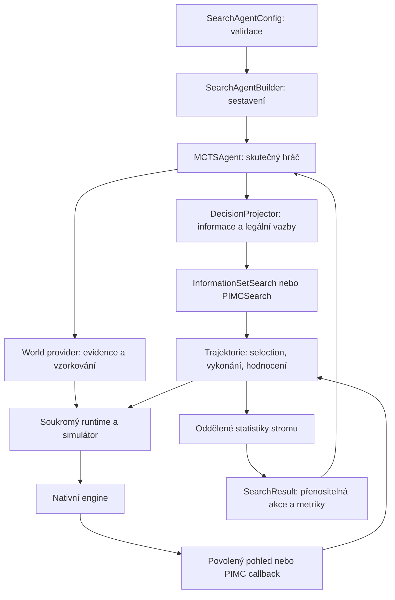

# Architektura AI

Pravidla hry vlastní engine; AI vybírá z jeho legálních nabídek. Složky
odpovídají odpovědnostem a životnosti objektů. Podrobný kontrakt informací
je v [AI_SEARCH](../../docs/AI_SEARCH.md), seznam **všech modulů, jejich tříd
a použití** v [inventuře](../../docs/generated/AI_MODULES_20261110.md).

## Propojení objektů



[SearchAgentBuilder](composition.py) je jediné místo sestavení policy,
generátoru, sampleru, modelu, search a controlleru. Každé `build()` vytvoří
oddělené cache a strom. `game.simulation.search_config` parsuje a validuje
JSON a předává nastavení builderu. Import balíčku nic nespouští, nenačítá
model a nezapisuje soubory.

## Kde změnu provést

| Složka | Odpovědnost a hlavní objekty | Relevance |
| --- | --- | --- |
| [agents](agents/) | `DecisionMaker`, `SimpleAgent`, `ModularAgent`, `MCTSAgent`, `TrivialAgent`, `OllamaSelector`, [OpenAISelector](agents/openai_policy.py); skutečný hráč. | Podle vybraného agenta; LLM provider se volí přes `llm.provider`. |
| [decisions](decisions/) | `PlayerAction`, `ChoiceDescriptor`, `DecisionProjector`, `SearchGenerationPolicy`, kandidáti, widening a bojové strategie. | Legální nabídky a přenositelný popis akcí. |
| [information](information/) | Observations, `PlayerInformation`, `PlayerKnowledge`, `PlayerRecall`, `RuntimeObservation`, `DigestNode`, neměnné hodnoty, [kompaktní vstup pro LLM](information/llm_observation.py). | Snapshot rozhraní běžně; živé čtení explicitně přes `runtime_observations`. |
| [evaluation](evaluation/) | `StateValueEvaluator`, `ObservationOpponentPolicy`, `prepared_products`, priory, encodery a omezené cache skóre. | Hodnocení a výběrová policy. |
| [search](search/) | [Společné datové kontrakty](search/contracts.py), IS-MCTS, PIMC, paralelní search, strom, statistiky a trajektorie. | Vybraný backend; výchozí je IS-MCTS. |
| [simulation](simulation/) | `SearchSimulator`, `CheckpointSimulator`, kopie, `WorldSavepoint`, `PriorityPosition`, explicitní pilot `MutationPosition`, PIMC runtime. | Vykonání sampled světa a bezpečný návrat. |
| [sampling](sampling/) | `GameOrigin`, `CurrentPositionWorlds`, history/population providery a evidence ruky/knihovny. | Výchozí current backend; history a scenario jsou samostatné podporované cesty. |
| [training](training/) | Self-play, `EpisodeRecorder`, `ReplayBuffer`, `PolicyValueModel`, `SelfPlaySearch`. | Explicitní self-play, neuronový model nebo trénink. |
| [experiments](experiments/) | Actor cache, části identity, odložené produkty a pravidlové/mana projekce. | Vypnuté prototypy nebo benchmark-only pomocníci. |
| [reference](reference/) | Taktický `PerfectInformationSearch` (minimax), `PrefixReplaySimulator`, `SampledScenario`. | Testovací a benchmarkové reference, nikoli další implicitně běžící MCTS. |

## Vlastnictví a životnost

| Objekt | Co vlastní | Životnost |
| --- | --- | --- |
| `MCTSAgent` | Skutečnou paměť, recall a svěřené moduly. | Živá hra / reset controlleru. |
| World provider | Sanitizovanou recipe a explicitně povolenou evidenci. | Podle ukotvení rozhodnutí a kontraktu provideru. |
| Search invocation (`_Run` / `_SearchRun`) | Sampled pool, přechodové cache a rozpracované statistiky. | Jedno volání search; retained statistiky mají vlastní omezenou paměť. |
| IS informační uzel | Informace a statistiky akcí podle dostupných informací. | Strom; může být společný více sampled světům. |
| PIMC path uzel | Popis cesty, akce a statistiky konkrétního světa. | Samostatný strom sampled světa. |
| Pracovní runtime / worker | Měnitelný `State`, karty, RNG, smyčku a callbacky. | Pouze jeho sampled svět; obnovuje se podle backendu. |
| `PriorityPosition` / `RecordCopyPlan` | Oddělenou kořenovou recipe a volitelné plány kopírování native komponent. Plány i předem ověřené vazby jsou ve výchozím nastavení vypnuté. | Jeden worker; každá obnova dostává vlastní dynamické komponenty a společné ownership memo. |
| `MutationPosition` / `MutationLedger` | Experimentální hybridní obnovu, první preimages vybraných záznamů a lokální revize pro cache. | Jeden instrumentovaný worker; při odchodu z experimentu se worker uvolní. |
| `ObservationReaders` | World-local handles, field cache a odvozené digesty. Dočasný rámec sdílí card digest mezi actorem a observerem po ověření viditelnosti. | Konkrétní runtime; rámec končí před akcí, kopie světa začíná bez něj. |
| `PlayerInformation` / `PreparedView` | Oddělené informace, identitu, metadata nebo skóre. | Rozhodnutí, cache či strom; žádné živé odkazy na cizí runtime. |

Strom není slovník `otisk → State`. Identita rozlišuje hráčsky rozeznatelné
situace; checkpoint ukládá vykonatelný runtime podle kontraktu simulátoru.
`DigestNode.freeze()` exportuje seed fakty, ne snapshot schopný obnovit pravidla.

## Důležité hranice

- **IS-MCTS a PIMC mají jinou informační smlouvu.** IS používá hráčské
  pohledy a simulační paměť; PIMC zná celý vzorkovaný svět. Sdílejí budget,
  result a metriky, nikoli volný přístup k runtime.
- **Snapshot a reader mají jinou životnost.** Snapshot lze uchovat; reader
  je živé okno během povoleného čtení. Do stromu patří oddělené produkty.
- **`RuntimeClone` a `SimulationClone` mají jiné hranice důvěry.** První
  chrání i sanitizaci skrytých dat, druhý optimalizuje důvěryhodnou kopii.
- **Checkpoint, position restore a replay jsou různé strategie.** Uložený
  vykonatelný bod není totéž jako obnova workeru a přehrání prefixu.

## Výběr PUCT

[Schéma 4](../../docs/AI_SEARCH.md#strukturované-podmínky-a-taktika-akcí--schéma-4)
používá [Requirement/RequirementEvaluator](evaluation/tactical_requirements.py),
[ActionTacticsBuilder](evaluation/action_tactics.py),
[TacticalFeatureEncoder](training/tactical_features.py) a
[TacticalPolicyValueModel](training/tactical_model.py). Konkrétní vztahy akcí
a AND/OR/sequence podmínky mají oddělené faktové a naučené části; učí se i
stromová agregace. Starší modely zůstávají podporované.

Deck-aware schéma 3 používá [DeckProfiler](evaluation/deck_profile.py),
[mechanické schopnosti](evaluation/card_mechanics.py) a aktuální
[TacticalContext](evaluation/tactical_context.py). Profily jsou immutable
produkty povolených decklistů; taktické vazby používají pouze viditelné aktuální
schopnosti. [DeckFeatureEncoder](training/deck_features.py) a
[DeckPolicyValueModel](training/deck_model.py) je zapojují do společného learneru.
Kontrakty a omezení popisuje [návod](../../docs/AI_SEARCH.md#deckprofiler-a-taktický-kontext--schéma-3).

[Sémantické entity a Deep Sets](../../docs/AI_SEARCH.md#sémantické-entity-a-deep-sets--schéma-2)
jsou explicitní nová cesta `model_representation: "semantic"`. Immutable definice
překládá [CardSemanticEncoder](evaluation/semantic_encoding.py), viditelné entity
a argumenty [EntityFeatureEncoder](training/entity_features.py), učení před
agregací zajišťuje [DeepSetsPolicyValueModel](training/deep_sets_model.py).
Původní pooled model a checkpointy zůstávají podporované; obě cesty sdílejí
`NeuralPrior`, `NeuralValue`, `NeuralPolicy` a learner orchestration.

Neuronový prior a přímou policy ze stejného checkpointu popisuje
[trénovací a inference cesta](../../docs/AI_SEARCH.md#neuronová-policy-pro-přímé-hraní-a-puct).
`make_neural_policy_controller` skládá živou projekci a `NeuralPolicy` bez sampleru
a search. Vlastní model, encoder a learner už patří do `training`.

[PUCTSelector](search/puct_selection.py) vlastní plochý výběr v IS-MCTS:
`Q(a) + c * P(a) * sqrt(max(1, N)) / (1 + n(a))`. `Q` je průměr
dokončených odměn z pohledu kořenového hráče, pro nenavštívenou akci nula.
`P` je normalizovaný prior z informací actora, `N` počet dokončených návštěv
uzlu a `n(a)` návštěvy konkrétní akce. Přerušená trajektorie se nezapočítává.

Selector dostává pouze aktuálně připuštěné akce; widening zachovává původní
priory celé nabídky a celkový počet návštěv uzlu. Volitelné počáteční pokrytí
vybírá nejprve nenavštívené akce podle prioru, včetně nulových priorů.
Shody řeší search RNG v pořadí nabídky. Selector nevlastní strom ani runtime
a nemění statistiky. `InformationSetSearch` zajišťuje priory, widening
a backpropagaci, `ActionHierarchy` samostatný hierarchický výběr. Protivníka
v IS-MCTS nadále řídí jeho observation-only policy.

## Experimenty a reference

V `experiments` jsou explicitní prototypy:

- `mutation_positions`, `mutation_player_rows`: společný záznam prvních zápisů
  pro hybridní obnovu workeru a revizní veřejné hráčské řádky.
  [Rozsah a měření](../../docs/experiments/mcts/MCTS_MUTATION_PROTOCOL_20261118.md).
  `mutation_world` rozšiřuje explicitní režim na nativní atributy, bitsety,
  registry, stack, boj, historii a knowledge; schéma vlastní simulation.
  [Rozšíření světa](../../docs/experiments/mcts/MCTS_WORLD_MUTATIONS_20261118.md).
  [Levnější příprava a zápisové bariéry](../../docs/experiments/mcts/MCTS_MUTATION_OVERHEAD_20261118.md)
  oddělují undo preimages od revizí a zachovávají kontrolní variantu.
  [Dočasné bitsety a volba obnovy](../../docs/experiments/mcts/MCTS_MUTATION_TEMPORARIES_20261118.md)
  porovnávají kopie výsledků dotazů a úplné preimages malých bitsetů;
  přínos je smíšený, přepínače zůstávají explicitní.
  `mutation_masks` vyhodnocuje nativní dotazy uvnitř registru nad `int`;
  veřejné `Query.eval` zachovává. [Implementace a měření](../../docs/experiments/mcts/MCTS_NATIVE_MASKS_20261118.md).
  [Připravené dotazy](../../docs/experiments/mcts/MCTS_PREPARED_QUERIES_20261118.md)
  vážou ověření na přijatý loan a revize indexů (`world_plans`).
  `direct_selectors` používá doménové nativní výběry karet a hráčů bez Query
  stromů; [profil a ablace GC](../../docs/experiments/mcts/MCTS_DIRECT_SELECTORS_20261119.md).
  Resource kontext `automatic_gc_disabled` vypíná automatický cyklický collector
  v izolovaném procesu; [no-GC srovnání](../../docs/experiments/mcts/MCTS_NO_GC_20261119.md).
  `native_identity_parts` zlevňuje Mapping dispatch a skládání podotisků polí
  po nativním headeru; [kontrakt a měření](../../docs/experiments/mcts/MCTS_IDENTITY_HITS_20261119.md).
  Navazující `native_rule_receipts` vrací čtyři uložené rule podotisky po
  ověření jejich field-cache plánů; [kontrakt a měření](../../docs/experiments/mcts/MCTS_NATIVE_RULE_RECEIPTS_20261119.md).
  Jeho režim `pooled=True` sdílí čistá `RuleFieldValues` ve stávajícím
  search-local `rule_groups` poolu; [životnost a měření](../../docs/experiments/mcts/MCTS_SHARED_RULE_BUNDLES_20261119.md).
  Volba `member_keys=True` rozpozná nové nativní kontejnery stejných definic,
  ale zachovává vlastní kontroly kolekcí každého řádku;
  [kapacitní ablace a klíče](../../docs/experiments/mcts/MCTS_RULE_BUNDLE_KEYS_20261119.md).
  `shallow_aliases=True` navíc odvozuje čistotu nového nativního obalu z
  ověřených členů a jeho vlastního tvaru; aktuální kolekce řádku se dál kontrolují.
  `knowledge_groups.knowledge_reads` zkouší opakované použití celých datových
  polí paměti místo lookupu každého listu; obsah zdrojů se stále ověřuje
  při čtení. [Rozpad mappingu a skupinová cache](../../docs/experiments/mcts/MCTS_KNOWLEDGE_GROUPS_20261119.md).
- `persistent_recall`, `compiled_dependencies`, `public_players`, `weak_fact_views`,
  `search_resources`, `combat_checkpoints`, `mana_payments`, `static_catalog`:
  sdílení immutable dat, závislosti, continuations a bounded cache. Import nic
  neaktivuje; kontexty nahrazující metody patří pouze do izolovaného sériového
  procesu. Rozsah a měření všech C01–C30 uvádí
  [implementační průchod katalogem](../../docs/experiments/mcts/MCTS_CATALOG_IMPLEMENTATIONS_20261116.md).
- `actor_identity_cache`, `actor_identity_parts` obsahují alternativní přípravu
  identity. Odvozené skóre a nezávislé ratings nyní vlastní
  [evaluation/prepared_products](evaluation/prepared_products.py).
  [Původní experiment](../../docs/experiments/mcts/MCTS_ACTOR_PREPARATION_20261109.md).
- `runtime_card_fields`, `runtime_knowledge`: sdružené cache polí a knowledge
  řádků; [výsledek](../../docs/experiments/mcts/MCTS_IDENTITY_CACHE_TRIALS_20261107.md).
- `compiled_rule_descriptions`, `observation_mana`: úzce ověřované projekční
  cache aktivované benchmarky; samy se do běžného search nezapínají.

Živé observations, inkrementální digesty, position worker a volitelné
`first_leaf` zůstávají u svých skutečných vlastníků. Jsou součástí
podporovaných cest, jejich zapnutí však stále závisí na konfiguraci.
Nízký počet importů není důkaz mrtvého kódu: reference mohou být záměrně
volané pouze testy nebo benchmarkem. Přehled použití je v inventuře.

## Importy a další úpravy

Ploché Python importy byly převedeny na skutečné vlastníky: například
`game.ai.information.runtime_digest`, `game.ai.search.information_set_search`
a `game.ai.agents.mcts_agent`. Callery v repozitáři jsou převedené; CLI
pod `game.bin` a JSON přepínače zůstávají stejné. Staré privátní cloudpickle
payloady s původními module paths je potřeba vytvořit znovu. Historické časy
se přesunem zdrojů nestávají novým měřením výkonu.

Inventuru obnovíš z `Cards`:

```powershell
python -B -m benchmarks.ai_architecture --output docs/generated/AI_MODULES_20261110.md
```

Bez `--output` jde výstup do stdout, žádná simulace se nespouští. Nový stav
přidej k objektu, který vlastní jeho invalidaci a životnost. Zkoušky výkonu
patří do `benchmarks`. Hranice hlídá
[test_ai_architecture.py](../../tests/test_ai_architecture.py); funkční testy
vybírej podle dotčeného backendu a pravidlové cesty.
